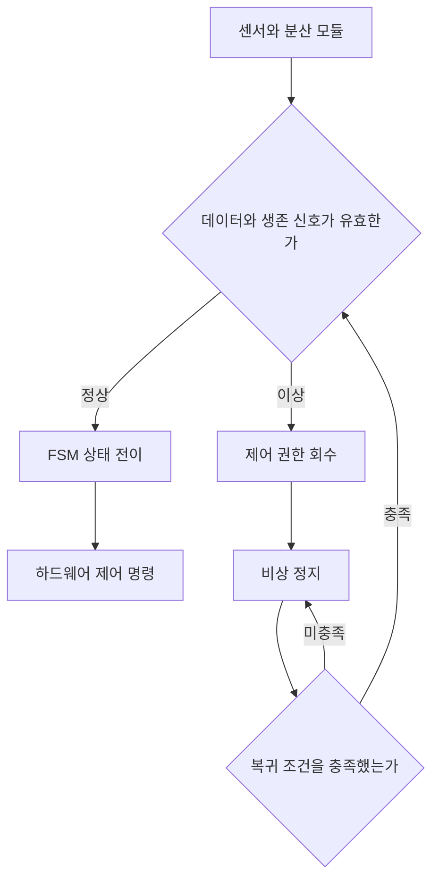

<link rel="stylesheet" href="{{ '/assets/css/image-carousel.css' | relative_url }}?v=20260805">

## 01. 프로젝트 개요
{: .autonomous-section-title}

### 참여 기간과 역할

2024년 11월부터 2025년 4월까지 웨어러블에이아이에서 차량 시스템 엔지니어로 근무하며 인천국제공항 제2여객터미널 자율주행 셔틀 도입 및 시범 운행 프로젝트에 참여했습니다.

### 담당 범위

차량 시스템의 센서 통신, 최상위 제어 구조, 분산 모듈 상태 감시와 고장 안전 로직을 개발했습니다.

  

    <figure class="image-carousel__slide" id="shuttle-photo-1">
      
      <figcaption>1 / 2. 여객 터미널에서 승객 탑승을 지원하는 셔틀</figcaption>
      <a class="image-carousel__nav image-carousel__nav--prev" href="#shuttle-photo-2" aria-label="이전 사진">‹</a>
      <a class="image-carousel__nav image-carousel__nav--next" href="#shuttle-photo-2" aria-label="다음 사진">›</a>
    </figure>
    <figure class="image-carousel__slide" id="shuttle-photo-2">
      
      <figcaption>2 / 2. 제2여객터미널에 배치된 직행 셔틀 차량</figcaption>
      <a class="image-carousel__nav image-carousel__nav--prev" href="#shuttle-photo-1" aria-label="이전 사진">‹</a>
      <a class="image-carousel__nav image-carousel__nav--next" href="#shuttle-photo-1" aria-label="다음 사진">›</a>
    </figure>
  

  
사진을 좌우로 밀거나 화살표를 눌러 넘길 수 있습니다.

---
## 03. 차량 FSM 개발
{: .autonomous-section-title}

차량의 상태를 제어하는 최상위 제어 모듈 설계

Perception, Decision, Control 여러 모듈들이 보내는 정보들을 통합해

---

## 04. 시스템 안정성 및 상태 감시
{: .autonomous-section-title}

Heartbeat 메시지의 발행 및 수신 방식을 구현해 SLAM과 인지 등 자율주행 분산 모듈의 작동 상태와 생존 여부를 실시간으로 감시했습니다.

- 모듈 별 생존 신호와 경고 및 오류 단계 수신과 상태 판정
- 센서 장애물 근접 경고나 모듈 오류 발생 시 하드웨어 제어 권한 회수
- 위험 상황에서 셔틀을 즉시 정지시키는 Fail-safe 로직 구현
- 분산 모듈의 이상 상태가 차량 제어 계층까지 전달되는 진단 흐름 구축

---

## 02. 센서 데이터 처리 및 네트워크 통신
{: .autonomous-section-title}

32kHz 샘플링 주파수와 600RPM 사양의 2D LiDAR 하드웨어 원시 데이터를 UDP 프로토콜로 직접 수신하고 해석하는 로직을 구현했습니다.

- 라이다의 Raw packet을 wireshark로 분석 후 socket io로 제어 명령과 스캔 결과 송/수신 
- 원 클릭 실행으로 RViz보다 상대적으로 빠른 비주얼라이즈, 디버그 파이프라인 구축

---
## 05. 설계 과정에서 고민한 점
{: .autonomous-section-title}

프로젝트를 회고하며 실제 구현 범위에서 중요했던 판단 기준을 다음과 같이 정리했습니다.
### 

### 빠른 장애 감지와 오탐지 사이의 균형 잡기

생존 신호 제한 시간이 너무 짧으면 순간적인 통신 지연에도 차량이 멈추고, 너무 길면 실제 장애 이후에도 운행 명령이 유지될 수 있습니다. 모듈의 중요도, 연속 누락 횟수, 마지막 정상 메시지의 시각, 경고 단계를 함께 보고 정지 여부를 결정하는 기준이 필요했습니다.

실제 차량을 탑승하고 테스트하고, 공항 측과의 여러 번의 시험 운행 끝에 Sliding-window 알고리즘을 응용해 적절한 로직을 작성할 수 있었습니다. 

### 일부 모듈의 고장을 차량 전체 안전으로 연결하기

SLAM, 인지, 센서 모듈은 서로 다른 시점에 고장 날 수 있습니다. 중앙 제어 계층은 현재 어떤 기능을 신뢰할 수 있는지 판단하고, 안전에 필요한 입력 하나라도 유효하지 않으면 하드웨어 제어 권한을 회수해야 합니다. 진단 메시지를 기록하는 데서 끝내지 않고 실제 정지 동작까지 이어지는 흐름을 설계한 이유입니다.

---

## 06. 차량 안전 제어 흐름
{: .autonomous-section-title}

센서 처리, 상태 전이, 모듈 감시는 서로 떨어진 기능이 아니라 하나의 안전 제어 흐름으로 연결됩니다.

---

## 07. 프로젝트를 마치며
{: .autonomous-section-title}

이 프로젝트를 통해 정상 운행 경로만큼 입력을 신뢰할 수 없는 순간의 동작을 명확히 정의하는 일이 중요하다는 것을 배웠습니다. 센서 데이터의 유효성, 상태 전이 조건, 분산 모듈의 고장 범위를 함께 살피고, 문제가 차량 전체로 전파되기 전에 안전 상태로 전환하는 기준을 세웠습니다.

이 경험은 실시간 시스템을 개발할 때 기능 구현에 앞서 어떤 입력을 신뢰할지, 어느 계층에서 실패를 차단할지, 어떤 조건에서 제어 권한을 돌려줄지를 먼저 설계하는 기준이 되었습니다.
