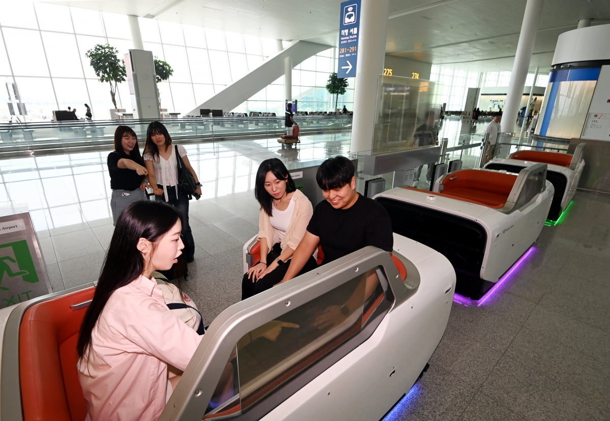
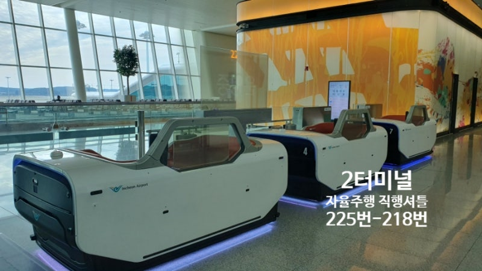
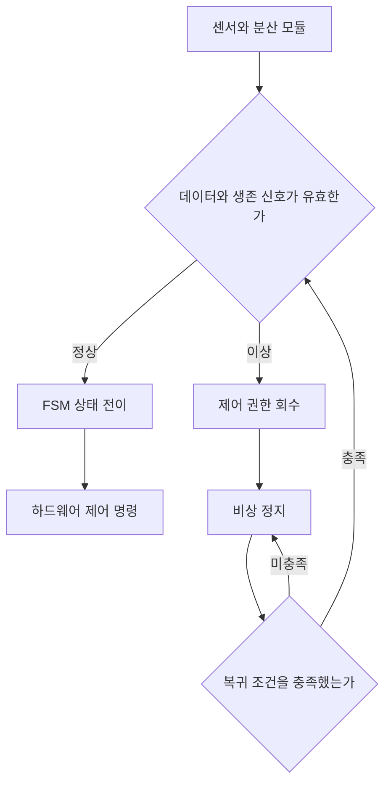

<link rel="stylesheet" href="{{ '/assets/css/image-carousel.css' | relative_url }}">

2024년 11월부터 2025년 4월까지 웨어러블에이아이에서 차량 시스템 엔지니어로 근무하며 인천국제공항 제2여객터미널 자율주행 셔틀 도입 및 시범 운행 프로젝트에 참여했습니다.

차량 시스템의 센서 통신, 최상위 제어 구조, 분산 모듈 상태 감시와 고장 안전 로직을 개발했습니다.

  

    <figure class="image-carousel__slide" id="shuttle-photo-1">
      
      <figcaption>1 / 2. 여객 터미널에서 승객 탑승을 지원하는 셔틀</figcaption>
      <a class="image-carousel__nav image-carousel__nav--prev" href="#shuttle-photo-2" aria-label="이전 사진">‹</a>
      <a class="image-carousel__nav image-carousel__nav--next" href="#shuttle-photo-2" aria-label="다음 사진">›</a>
    </figure>
    <figure class="image-carousel__slide" id="shuttle-photo-2">
      
      <figcaption>2 / 2. 제2여객터미널에 배치된 직행 셔틀 차량</figcaption>
      <a class="image-carousel__nav image-carousel__nav--prev" href="#shuttle-photo-1" aria-label="이전 사진">‹</a>
      <a class="image-carousel__nav image-carousel__nav--next" href="#shuttle-photo-1" aria-label="다음 사진">›</a>
    </figure>
  

  
사진을 좌우로 밀거나 화살표를 눌러 넘길 수 있습니다.

## 센서 데이터 처리 및 네트워크 통신

32kHz 샘플링 주파수와 600RPM 사양의 2D LiDAR 하드웨어 원시 데이터를 UDP 프로토콜로 직접 수신하고 해석하는 로직을 구현했습니다.

- 맞춤형 LiDAR 패킷의 수신, 검증, 해석 흐름 구현
- 비전 센서 없이 포인트 클라우드를 사용하는 3차원 인지 환경에 맞춘 센서 데이터 처리 흐름 구축
- 맞춤형 하드웨어와 자율주행 시스템 사이의 안정적인 데이터 연동 확보

## 주행 시나리오 기반 시스템 구조 및 제어 로직

승객 탑승, 대기, 주행 등 공항 셔틀 운행 시나리오를 시스템 상태와 전이 조건으로 정의하고 C++/ROS2 기반 최상위 제어 로직을 구현했습니다.

- 상태별 책임과 전이 조건을 분리한 FSM 설계
- 모든 운행 상태에서 즉시 비상 정지로 전환할 수 있는 전역 상태 전이 구성
- 안전 조건을 충족한 뒤 운행 흐름으로 복귀할 수 있는 양방향 비상 정지 구조 설계

## 시스템 안정성 및 상태 감시

생존 신호 메시지의 발행 및 수신 방식을 구현해 SLAM과 인지 등 자율주행 분산 모듈의 작동 상태와 생존 여부를 실시간으로 감시했습니다.

- 모듈별 생존 신호와 경고 및 오류 단계 수신과 상태 판정
- 센서 장애물 근접 경고나 모듈 오류 발생 시 하드웨어 제어 권한 회수
- 위험 상황에서 셔틀을 즉시 정지시키는 고장 안전 로직 구현
- 분산 모듈의 이상 상태가 차량 제어 계층까지 전달되는 진단 흐름 구축

## 구현 범위에서 정리한 설계 고민

프로젝트를 회고하며 실제 구현 범위에서 중요했던 판단 기준을 다음과 같이 정리했습니다.

### 수신한 센서 데이터를 언제 신뢰할 것인가

UDP는 전송 지연이 짧은 대신 패킷의 도착과 순서를 보장하지 않습니다. 따라서 데이터를 받았다는 사실과 제어에 사용할 수 있다는 판단을 분리해야 했습니다. 패킷 길이와 헤더, 측정 범위, 시간 정보의 유효성을 확인하고, 오래되거나 불완전한 프레임이 인지 계층으로 전파되지 않도록 수신, 해석, 사용 단계를 나누는 방향을 검토했습니다.

### 비상 정지를 예외가 아닌 운행 상태로 다루기

상태마다 비상 정지 전이를 반복해서 넣으면 빠진 경로가 생기기 쉽습니다. 모든 상태에서 하나의 전역 비상 정지 상태로 진입하게 하고, 정지 원인이 해소됐다는 이유만으로 이전 명령을 다시 실행하지 않도록 복귀 조건과 제어 권한 재확보 조건을 분명히 두는 것이 중요했습니다.

### 빠른 장애 감지와 잘못된 정지 사이의 균형 잡기

생존 신호 제한 시간이 너무 짧으면 순간적인 통신 지연에도 차량이 멈추고, 너무 길면 실제 장애 이후에도 운행 명령이 유지될 수 있습니다. 모듈의 중요도, 연속 누락 횟수, 마지막 정상 메시지의 시각, 경고 단계를 함께 보고 정지 여부를 결정하는 기준이 필요했습니다.

### 일부 모듈의 고장을 차량 전체 안전으로 연결하기

SLAM, 인지, 센서 모듈은 서로 다른 시점에 고장 날 수 있습니다. 중앙 제어 계층은 현재 어떤 기능을 신뢰할 수 있는지 판단하고, 안전에 필요한 입력 하나라도 유효하지 않으면 하드웨어 제어 권한을 회수해야 합니다. 진단 메시지를 기록하는 데서 끝내지 않고 실제 정지 동작까지 이어지는 흐름을 설계한 이유입니다.

## 차량 안전 제어 흐름

센서 처리, 상태 전이, 모듈 감시는 서로 떨어진 기능이 아니라 하나의 안전 제어 흐름으로 연결됩니다.

## 프로젝트를 마치며

이 프로젝트를 통해 정상 운행 경로만큼 입력을 신뢰할 수 없는 순간의 동작을 명확히 정의하는 일이 중요하다는 것을 배웠습니다. 센서 데이터의 유효성, 상태 전이 조건, 분산 모듈의 고장 범위를 함께 살피고, 문제가 차량 전체로 전파되기 전에 안전 상태로 전환하는 기준을 세웠습니다.

이 경험은 실시간 시스템을 개발할 때 기능 구현에 앞서 어떤 입력을 신뢰할지, 어느 계층에서 실패를 차단할지, 어떤 조건에서 제어 권한을 돌려줄지를 먼저 설계하는 기준이 되었습니다.
