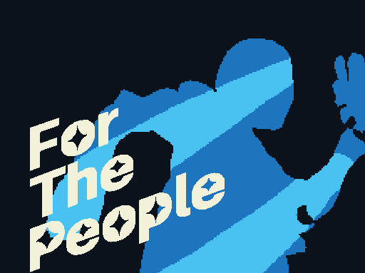

**For the people**은 GMTK Game Jam 2026에 제출한 Unity 기반 top-down action game입니다.

> SAVE THEM BEFORE THE BLASTS REDRAW THE CITY

폭발이 도시를 바꾸기 전에 사람들을 구조하는 짧은 플레이 경험을 목표로 제작했습니다. 브라우저에서 바로 실행할 수 있는 HTML5 빌드로 공개했습니다.

## Controls

- 이동: 마우스 클릭 또는 `WASD`
- Bullet time 증폭: `Space`
- 재시도: `R`

## 결과물

제한된 Game Jam 일정 안에서 조작, 게임 규칙, 실패와 재시도 흐름을 하나의 플레이 가능한 빌드로 마무리했습니다.

[Play on itch.io](https://haelime.itch.io/for-the-people)

[Original Notion Page](https://app.notion.com/p/Game-jam-366b4a6f757780d2a6d7da6e71df04f9?source=copy_link)
