[](https://haelime.itch.io/for-the-people)

[**For the people 플레이하기**](https://haelime.itch.io/for-the-people)

### 조작법

- 이동: 마우스 클릭이나 화면 터치 또는 옵션에서 `WASD` 모드 선택
- 불릿 타임 증폭: `Space`를 누르고 있기(모바일은 두 손가락 터치)
- 재시도: `R` 또는 결과 화면의 `RETRY`

**For the people**은 GMTK Game Jam 2026에 제출한 Unity 기반 탑다운 액션 게임입니다.

> 폭발이 도시를 바꾸기 전에 모두 구조하세요.

GMTK Game Jam 2026의 주제인 **COUNTDOWN**을 바탕으로 제작했습니다. 브라우저에서 바로 실행할 수 있는 HTML5 실행본으로 공개했습니다.

## 게임 진행 구조

전체 흐름을 `Planning → BulletTime → Won/Lost → Thanks` 단계로 관리했습니다. 각 단계에서 허용되는 입력과 갱신 대상을 분리하고, 재시도할 때 현재 라운드의 동적 객체를 정리한 뒤 레벨 프리팹으로 다시 구성합니다.

시민은 `Waiting`, `Carried`, `Rescued`, `Lost` 상태를 가집니다. 플레이어는 한 번에 최대 3명을 운반할 수 있으며, 구조 지점에 도착하면 탑승한 시민만 `Rescued`로 전환됩니다.

## 두 시간축으로 구현한 불릿 타임

플레이어 이동, 입력, UI, 폭탄 점화 지연은 `Time.unscaledDeltaTime`으로 갱신하고 충격파 확산은 `Time.deltaTime`을 사용했습니다. 따라서 `timeScale`을 낮추면 세계의 위험은 느려지지만 플레이어의 조작 속도는 유지됩니다.

```csharp
float scale = activeSlowMotion *
    (amplificationActive ? AmplificationScale : 1f);
Time.timeScale = scale;
Time.fixedDeltaTime = 0.02f * scale;
```

추가 감속은 충전 게이지를 소비하며, 소진 후에는 입력을 놓아야 다시 충전됩니다. `fixedDeltaTime`도 같은 비율로 조절해 시간 배율이 바뀌어도 실제 시간 기준 물리 갱신 간격이 급격히 달라지지 않도록 했습니다.

## 원형 충격파와 구조 판정

폭발마다 중심, 시작 지연, 현재 반지름을 관리합니다. 플레이어는 중심과의 거리가 충격파 반지름에 가까워지는 순간 피격되고, 대기 중인 시민은 충격파가 위치를 통과하면 `Lost`로 전환됩니다. 여러 폭탄은 서로 다른 지연 시간으로 확산되어 안전 경로가 시간에 따라 바뀝니다.

폭발 전에는 3초 간격의 충격파 윤곽선과 최종 폭발 범위를 그려 플레이어가 이동 경로를 계획할 수 있게 했습니다.

## 데이터 기반 10개 레벨과 검증 도구

`LevelLayout` 프리팹이 계획 시간, 감속 비율, 폭발 반경, 폭탄 위치와 지연, 구조 지점과 시민 배치를 보유합니다. 잼 시제품에서는 `CountdownGameDirector` 하나가 단계 전환과 라운드 생명주기를 조정하고, 이 데이터로 라운드 객체를 생성합니다. 새로운 레벨을 추가할 때 게임 진행 코드를 수정하지 않도록 레벨 구성과 실행 로직을 분리했습니다.

`CountdownGameDirector`에 라운드 생성, 폭발과 구조 판정, UI와 음향 갱신을 모은 것은 짧은 제작 기간에 전체 흐름을 빠르게 완성하기 위한 선택입니다. 규모가 커진다면 각 책임을 별도 시스템으로 분리할 수 있지만, 이번 잼 범위에서는 하나의 통합 조정자로 유지했습니다.

편집기 생성 도구로 10개 레벨 프리팹을 만들고 기본 동작 검사에서 레벨 순서, 폭탄과 시민 수, 프리팹 참조, 후반 레벨의 구조 가능 시간을 확인했습니다. 마우스, WASD, 게임패드와 터치 입력을 같은 이동 로직으로 연결했으며, 감속 증폭 중에는 `BakeMesh`로 현재 자세를 추출한 잔상과 `MaterialPropertyBlock`의 투명도 변화로 속도감을 표현했습니다.

## 결과물

총 10,394개 작품이 출품된 GMTK Game Jam 2026에서 조작, 게임 규칙, 실패와 재시도 흐름을 하나의 플레이 가능한 빌드로 마무리했습니다.

창의성 부문 326위, 재미 부문 382위를 기록했습니다.

| 부문 | 순위 | 점수 |
| --- | ---: | ---: |
| 창의성 | 326위 | 4.292 |
| 재미 | 382위 | 4.042 |
| 음향 | 1,220위 | 3.500 |
| 서사 | 2,813위 | 2.833 |
| 그래픽 | 2,890위 | 3.458 |

[GMTK 게임 잼 출품작 보기](https://itch.io/jam/gmtk-jam-2026/rate/4820527)
