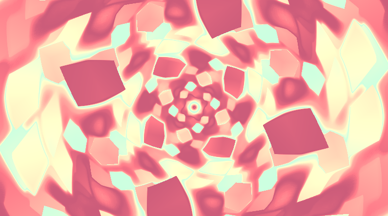

수학적 거리 함수와 raymarching으로 메시 없이 공간과 볼륨을 표현한 셰이더 프로젝트입니다. 표면과 내부 볼륨을 함께 렌더링하는 **Cloudy Crystal**, 반복되는 SDF 공간을 구성한 **Cubestorm** 두 작업을 담았습니다.

## Cloudy Crystal

  <iframe src="https://www.youtube.com/embed/sKYhIVCjzfU" title="Cloudy Crystal shader preview" allowfullscreen></iframe>

반투명 보석 내부에 움직이는 구름이 들어 있는 판타지 아이템 셰이더입니다. 하나의 pass 안에서 표면 렌더링과 volumetric raymarching을 결합했습니다.

### Surface Rendering

- GrabPass와 normal 기반 UV distortion으로 배경 굴절 표현
- 여러 offset sample을 이용한 frosted glass blur
- RGB channel을 독립적으로 이동한 chromatic aberration
- MatCap, cubemap reflection, Fresnel을 조합한 표면 조명
- 시야각에 따라 색이 변하는 prismatic specular

### Internal Volumetric Clouds

Raymarching은 object local space에서 수행합니다. 오브젝트가 이동하거나 회전해도 내부 구름이 메시에 고정됩니다.

- Noise로 변형한 sphere SDF
- 3 octave FBM을 이용한 구름 밀도
- 시간과 flow direction에 따른 내부 애니메이션
- iteration count로 근사한 self-shadowing
- gradient normal과 view direction으로 계산한 rim light

## Cubestorm

GLSL raymarching으로 무한히 반복되는 큐브 터널을 렌더링합니다. 기하 mesh 대신 box SDF와 좌표 변환만으로 장면을 정의했습니다.

### 핵심 기법

- **Sphere Tracing:** SDF가 반환한 거리만큼 ray를 전진
- **Box SDF:** 내부와 외부 거리를 모두 처리하는 signed distance function
- **Domain Repetition:** `fract()`로 공간을 접어 하나의 cube를 무한히 반복
- **Space Twisting:** ray 진행 거리에 따라 XY 좌표를 회전해 터널을 나선형으로 변형
- **Cosine Palette:** texture 없이 거리와 step에 따른 procedural color 생성

최대 거리 이후에는 loop를 조기 종료하고, 가능한 계산은 `min`, `max`, `step`으로 표현해 불필요한 branch를 줄였습니다.

[View Cubestorm on Shadertoy](https://www.shadertoy.com/view/lffGRj)
