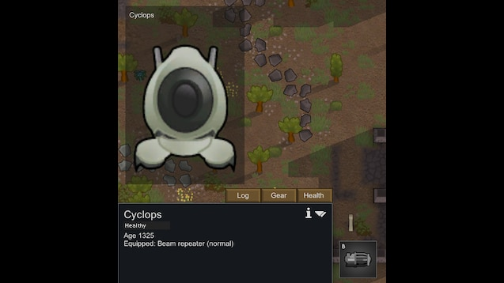

RimWorld의 선택 상태와 UI 표시 흐름을 분석해, 현재 선택한 Pawn의 portrait를 HUD 위에 표시하는 C# mod를 구현했습니다.

## 코드 분석과 구현

기존 UI의 선택 상태, portrait 표시 방식, 화면 배치를 분석한 뒤 기존 동작을 유지하면서 필요한 정보만 추가했습니다.

- 선택된 Pawn 데이터가 UI에 반영되는 흐름 분석
- 기존 HUD와 충돌하지 않는 portrait overlay의 갱신 및 배치 구현
- 플레이 중 선택 상태를 빠르게 인지할 수 있도록 정보 우선순위 조정

## 배포와 실사용 검증

- Steam Workshop 구독자 **2,000명**
- 사용자 평가 **96% 긍정적**

기존 코드와 동작을 파악하고, 기능을 구현해 배포한 뒤 실제 사용자 지표로 완성도를 확인했습니다. 코드 분석부터 출시와 검증까지 이어지는 실무형 개발 과정을 경험한 프로젝트입니다.

[View on Steam Workshop](https://steamcommunity.com/sharedfiles/filedetails/?id=3685326018)
