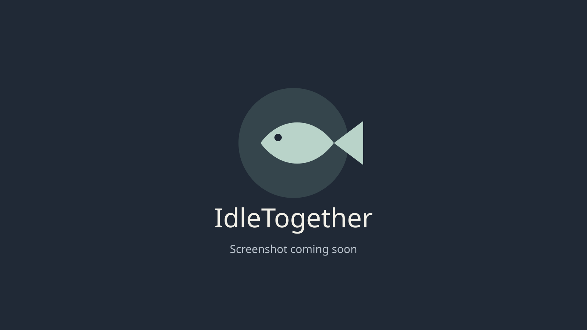

IdleTogether는 작업하는 동안 데스크톱 한쪽에 머물며 가끔 들여다볼 수 있는 멀티플레이 낚시 게임입니다. 플레이어가 자리를 비운 사이에도 부담 없이 이어지는 작은 세계와, 다른 사람과 같은 공간에 머무는 감각을 만드는 것이 목표입니다.

초기에는 섬 위에 건물을 배치하고 드론이 자원을 운반하는 방치형 건설 시뮬레이션으로 시작했습니다. 구현을 진행하며 핵심 경험을 더 단순하고 관찰하기 쉬운 낚시로 좁혔고, 기존 건설·생산·해금 시스템을 제거하면서 플레이어 이동과 멀티플레이 기반은 새 게임 루프에 맞게 재구성하고 있습니다.

## 낚시를 중심으로 다시 구성한 게임 루프

플레이어가 섬 가장자리를 클릭하면 NavMesh 위의 낚시 가능한 위치를 계산하고 해안으로 이동합니다. 도착한 뒤에는 `Casting → Waiting → Reeling` 단계가 이어집니다. 입질이 오면 화면에 나타나는 표적을 클릭해 포획 진행도를 높이고, 제한 시간 안에 물고기가 요구하는 힘을 채우면 인벤토리에 기록합니다.

플레이어의 상위 행동은 `Idle`, `Moving`, `MovingToFish`, `Fishing` 등의 상태로 관리하고, 낚시 내부 단계는 별도의 상태로 분리했습니다. 이동 명령과 낚시 갱신 조건을 한 상태 머신에서 조정하되, 물고기 선택과 클릭 판정은 `PlayerFishingController`가 담당합니다. 덕분에 낚시 중 들어온 이동 명령을 거부하거나 해안 도착 시점에만 캐스팅을 시작하는 규칙을 명시적으로 표현할 수 있습니다.

입질 시간, 표적 크기와 이동 거리, 자동 릴의 힘, 정밀 클릭 배율은 계산 함수로 분리했습니다. 무작위 결과가 개입하는 구간도 정규화된 입력값을 받도록 만들어 규칙을 독립적으로 검증할 수 있게 했습니다.

## 데이터 기반 물고기와 수집 기록

물고기, 접두사, 낚싯대와 미끼는 `ScriptableObject` 정의로 구성했습니다. 현재 시제품에는 물고기 5종, 크기·무게를 바꾸는 접두사 3종, 낚싯대 2종과 미끼 2종이 연결되어 있습니다.

한 번의 포획 결과는 종 이름만 저장하지 않습니다. 고유 포획 ID, 물고기 ID, 희귀도, 등급, 크기, 무게, 접두사와 즐겨찾기 여부를 하나의 `FishCatchRecord`로 기록합니다. 같은 종을 여러 번 낚아도 서로 다른 개체로 보관할 수 있고, 이 기록으로 다음 정보를 계산합니다.

- 전체 포획 수, 발견한 종 수와 전설 등급 포획 수
- 누적 무게, 가장 큰 물고기와 가장 무거운 물고기
- 종별 포획 횟수와 개인 최고 기록
- 즐겨찾기를 보호하는 개별 판매와 일괄 판매

## 수집·장비·경제를 연결한 UI

인벤토리는 보유 물고기, 낚시 장비와 코스메틱을 같은 탐색 UI에서 분류해 보여 줍니다. 선택한 물고기의 외형을 별도 렌더 텍스처로 미리 보고 즐겨찾기나 판매를 실행할 수 있습니다. 장비는 구매 여부와 현재 착용 상태를 나누며, 미끼는 입질 시간을 줄이는 소비 아이템으로 처리했습니다.

물고기를 판매해 얻은 코인은 네 가지 성장 요소로 다시 순환합니다.

- 자동 릴 진행도
- 정밀 클릭의 힘
- 물고기 인벤토리 용량
- 미끼 보유 한도

진행 데이터는 물고기 목록, 보유·착용 장비, 코스메틱, 코인과 업그레이드 단계까지 묶어 JSON으로 저장합니다. 세 개의 로컬 슬롯을 제공하고, 불러올 때 저장 버전과 문자열 길이, 물고기 수, 장비 소유 관계와 성장 단계 범위를 검사해 잘못된 데이터가 런타임 상태에 바로 적용되지 않도록 했습니다.

## 서버 권위형 멀티플레이

Unity Netcode for GameObjects와 Unity Transport를 사용해 Host, Client, Server 실행 흐름을 구성했습니다. 네트워크 세션을 시작하면 오프라인 플레이어를 숨기고 각 클라이언트의 네트워크 플레이어를 NavMesh 위에 배치하며, 세션을 종료하면 오프라인 상태로 되돌립니다.

클라이언트는 이동 목적지나 낚시 클릭 위치를 서버에 요청합니다. 실제 이동, 낚시 상태 갱신과 성공 판정은 서버 시간으로 처리하고, 서버가 다음 값을 `NetworkVariable`로 복제합니다.

- 플레이어의 이동 속도와 상위 행동 상태
- 현재 낚시 단계와 포획 진행도
- 남은 릴링 시간과 필요한 포획 힘
- 클릭 표적의 위치와 반지름

포획 결과와 머리 코스메틱도 네트워크를 통해 공유합니다. 입력을 보낸 클라이언트가 결과를 직접 확정하지 않도록 하여, 여러 플레이어에게 동일한 상태를 보여 주는 기반을 만들었습니다. Steamworks.NET 초기화도 프로젝트에 연결했으며, Steam 로비와 원격 접속 흐름은 이후 검증·통합할 영역입니다.

## 검증 가능한 규칙으로 분리하기

현재 낚시 규칙, 장비·상점·저장, 인벤토리 프리팹과 멀티플레이 창을 대상으로 Editor 테스트 23개를 작성했습니다. 테스트는 다음과 같은 경계를 확인합니다.

- 희귀도에 따른 요구 포획 힘과 미끼 등급에 따른 물고기 선택 제한
- 클릭 위치와 다음 표적 사이의 최소 거리 및 정밀 클릭 배율
- 중복 포획 거부, 도감·통계 집계와 크기·무게 표시 형식
- 장비 소유·착용, 미끼 소비, 즐겨찾기를 제외한 일괄 판매
- 저장 데이터 JSON 왕복과 UI 프리팹 참조

자동 테스트를 작성한 상태와 실제 플레이 환경에서 검증을 마친 상태는 구분하고 있습니다. 다음 단계는 Unity Play Mode에서 전체 낚시 루프를 회귀 테스트하고, Steam을 실행한 두 클라이언트에서 접속·이동·낚시·코스메틱·재접속 시나리오를 확인하는 것입니다.

## 현재 상태와 다음 목표

현재 프로젝트는 낚시 피벗을 통합하는 개발 단계입니다. 핵심 루프와 수집·경제·저장, 권위형 플레이어의 첫 구현은 연결했지만, 대규모 레거시 제거 이후의 씬 참조 검사와 멀티클라이언트 검증, 콘텐츠 밸런싱과 연출 폴리싱이 남아 있습니다.

이 프로젝트에서 가장 중요한 과제는 기능 수를 늘리는 것보다 방치해도 불이익이 없고, 잠깐 바라보는 것만으로 편안하며, 다른 플레이어의 존재가 방해가 아닌 온기로 느껴지는 흐름을 만드는 것입니다. 낚시라는 반복 가능한 작은 행동을 중심으로 그 경험을 계속 다듬고 있습니다.

[GitHub에서 소스 보기](https://github.com/haelime/IdleTogether-2026-06-24_16-19-29)
