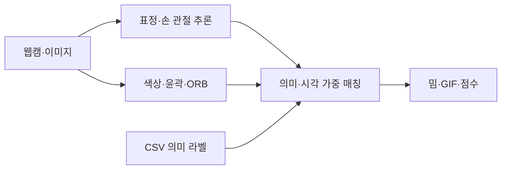

카메라 앞에서 웃거나 손가락을 들면, 지금 모습과 가장 잘 맞는 고양이 밈이 나타납니다.

**표정 7종 · 손동작 6종 · ONNX 모델 3개 · Windows 배포 자동화 · CTest 2/2 통과**

얼굴·표정·손 관절 추론을 하나의 실시간 파이프라인으로 연결하고, 결과를 단순 분류에서 끝내지 않고 실제 밈 추천과 GIF 재생까지 완결했습니다.

## 무엇을 만들었나

웹캠이나 이미지에서 얼굴, 표정, 손바닥과 21개 손 관절을 분석합니다. 그 결과를 밈의 색상·윤곽·ORB 특징 및 작성된 의미 라벨과 함께 점수화해 가장 가까운 밈을 보여 줍니다.

## 무엇이 의미 있나

서로 목적이 다른 세 ONNX 모델의 출력을 공통 상태로 정리하고, `none`을 포함한 의미 라벨과 시각 특징을 한 점수 체계에 결합했습니다. 손동작은 4회 확인·2회 누락 규칙으로 시간축 상태를 분리했고, CUDA 추론이 실패하면 같은 요청을 CPU로 다시 수행하도록 경계를 뒀습니다.

여기서 성능 향상 수치는 주장하지 않습니다. CUDA와 매칭 가중치는 구현되어 있지만, 하드웨어별 지연 시간과 라벨된 평가셋으로 아직 측정하지 않았기 때문입니다.

## 내가 한 일

- 얼굴 검출 → 표정 분류 → 손바닥 검출 → 21개 관절 추정을 연결하고, 웹캠·정지 이미지 입력과 결과 UI를 구현했습니다.
- 이미지·GIF 밈을 인덱싱하고 시각 특징과 표정·손동작 라벨을 결합하는 가중 매칭, 손동작 안정화, CPU fallback을 구현했습니다.
- OpenCV 5.0 빌드와 CTest를 자동화하고, 실행 파일·에셋·FFmpeg·VC++ 런타임을 검증한 뒤 ZIP과 SHA-256을 만드는 Windows 릴리스 절차를 작성했습니다.

## 왜 이 기술을 골랐나

| 기술 | 선택 이유 |
| --- | --- |
| C++17 | OpenCV DNN과 영상 처리 자원을 직접 제어하고 Windows 실행 파일로 묶기 위해 사용했습니다. |
| OpenCV 5.0 | 카메라·이미지·영상 디코딩, DNN 추론, 특징 추출과 결과 표시를 한 런타임에서 처리할 수 있습니다. |
| ONNX | 표정·손바닥·손 관절 모델을 같은 OpenCV DNN 백엔드에서 실행할 수 있습니다. |
| CMake + PowerShell | 빌드, 테스트, Windows 의존성 수집과 배포 검증을 반복 가능한 명령으로 고정했습니다. |

## Troubleshooting — 실행 파일이 아니라 릴리스 ZIP 자체를 검증하기

### 문제 인지

8월 27일 구현 커밋에는 실행 파일과 에셋 복사까지 있었지만, 다른 PC에 전달할 단위는 정의되어 있지 않았습니다. 실행에는 ONNX 모델, Haar Cascade, 밈, CSV, OpenCV FFmpeg 플러그인과 VC++ 런타임이 함께 필요합니다. 컴파일 성공만으로는 이 파일들의 누락을 잡을 수 없습니다.

### 원인과 해결 의도

개발 PC는 이미 설치된 의존성과 소스 디렉터리 때문에 빠진 파일을 가릴 수 있습니다. 그래서 검증 대상을 개발 폴더의 실행 파일이 아니라 **사용자가 받는 ZIP의 내용물**로 옮겼습니다.

### 적용

8월 28일 `build: add release packaging script` 커밋에서 릴리스 절차를 별도 스크립트로 고정했습니다.

1. Release 빌드와 CTest 실행
2. 실행 파일, 작성된 에셋, FFmpeg 플러그인, x64 VC++ 런타임 수집
3. 원본과 패키지의 모든 에셋 경로·파일 크기 대조
4. 패키지 안의 실행 파일로 `--check-assets` 실행
5. 검증된 폴더만 ZIP으로 압축하고 SHA-256 생성

### 검증과 재발 방지

현재 `cat_meme_tests`와 `cat_meme_bundled_assets`가 모두 통과합니다. 패키지에 작성된 에셋이 하나라도 없거나 크기가 다르면 ZIP을 만들기 전에 실패하고, 완성된 패키지 내부 실행 파일도 다시 에셋을 인덱싱해야 통과합니다.

이 방식은 Windows CPU 패키지만 다룹니다. CUDA 빌드와 다른 운영체제 배포는 아직 같은 수준으로 자동화하지 않았습니다.

## 증빙

- [GitHub Repository](https://github.com/haelime/cat-meme-detector)
- 구현 커밋: `2176321` (`init`)
- 릴리스 자동화 커밋: `fa2f885` (`build: add release packaging script`)
- 공개 Live Demo / GitHub Release: 아직 없음
