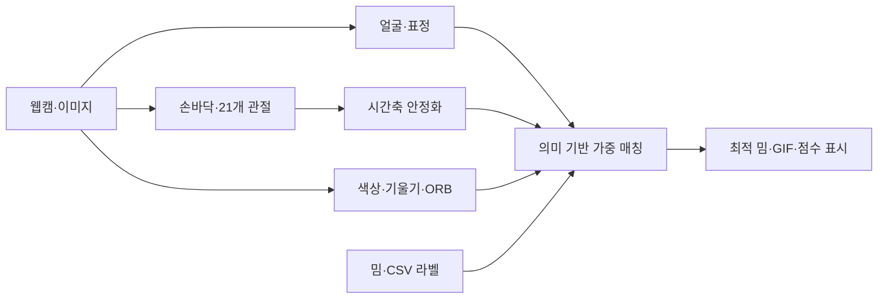

카메라 앞에서 웃거나 손가락을 들면, 그 순간과 가장 잘 맞는 고양이 밈이 나타납니다.

**7가지 표정 · 6가지 손동작 · ONNX 모델 3개 · CPU/CUDA 전환 · Windows Release 패키징 · CTest 2/2 통과**

C++17과 OpenCV 5.0으로 얼굴·표정·손 관절 추론부터 의미 기반 매칭, GIF 재생, 빌드와 배포 검증까지 완성했습니다. 핵심은 모델을 많이 연결한 것이 아닙니다. **매 프레임 흔들리는 AI의 관측값을 사용자가 믿을 수 있는 하나의 상태로 바꾼 것**입니다.

[GitHub에서 소스 보기](https://github.com/haelime/cat-meme-detector)



이 글은 프레임 단위 추론을 실시간 제품에 바로 연결했을 때 무엇이 깨지는지, 그 문제를 어떻게 재현 가능한 규칙과 회귀 테스트로 바꿨는지를 설명합니다.

## 문제 1. 모델은 동작하는데 밈이 계속 바뀌었다

손 관절 모델은 현재 프레임만 봅니다. 손이 가려지거나 빠르게 움직이면 `pointing` 다음에 `none`, `thumbs-up`, `fist`가 짧게 섞일 수 있습니다. 이 값을 즉시 추천에 사용하면 한두 번의 오검출만으로 밈이 바뀝니다. 모델의 평균 정확도와 별개로 화면은 불안정해집니다.

### 재현

순간 오검출을 다음 관측열로 고정했습니다.

```text
pointing → none → thumbs-up → fist → other → none
```

서로 다른 값이 한 번씩 나타났을 뿐인데 추천 상태가 따라 바뀐다면 문제를 재현한 것입니다. 반대로 실제 동작은 같은 값이 연속해서 들어오고, 손을 잠깐 놓쳐도 바로 사라지지 않아야 합니다.

### 해결 의도

여기서 구분해야 할 것은 **관측**과 **확정된 사용자 상태**였습니다. 잘못된 밈을 즉시 보여 주는 비용이 수 프레임 늦게 반응하는 비용보다 크다고 판단했습니다. 그래서 DNN 클래스는 현재 관측만 반환하고, 시간에 따른 확정과 해제는 별도의 `HandGestureStabilizer`가 맡도록 책임을 나눴습니다.

### 적용

- 같은 손동작이 4회 연속 관측되어야 활성화
- 활성 상태에서 손을 한 번 놓쳐도 유지
- 두 번 연속 놓쳤을 때만 `none`으로 해제
- 웹캠 DNN 분석은 5프레임마다 수행

앞의 오검출 관측열은 끝까지 `none`으로 남습니다. `pointing`이 네 번 이어지면 그때 확정되고, 이어지는 첫 번째 `none`에는 유지되다가 두 번째 `none`에서 해제됩니다.

### 재발 방지

두 시나리오를 회귀 테스트로 고정했습니다.

1. 서로 다른 순간 오검출은 어떤 동작도 활성화하지 않는다.
2. 네 번의 일관된 관측은 활성화하고, 두 번의 누락은 해제한다.

튜닝 값이 바뀌거나 상태 코드가 리팩터링되어도 “오검출 억제”와 “정상 동작 확정”을 함께 검사합니다. 안정성을 높인 대가로 빠른 동작에는 반응 지연이 생기며, 이 값은 향후 실제 사용자 입력 데이터로 다시 조정해야 합니다.

## 문제 2. 손이 없는데 손동작 밈이 선택됐다

시각 특징만으로 밈을 고르면 색과 윤곽이 닮았다는 이유로 손가락을 가리키는 밈이 선택될 수 있습니다. 더 까다로운 경우는 두 이미지의 시각 특징이 사실상 같지만 하나는 `pointing`, 다른 하나는 `none`인 상황입니다. 입력에 손이 없다는 사실을 점수에 반영하지 않으면 파일 순서나 작은 점수 차이가 의미보다 앞설 수 있습니다.

### 재현

테스트용으로 같은 이미지 두 장에 서로 다른 라벨을 부여했습니다.

```text
a_pointing.png → neutral, pointing
z_no_hand.png  → neutral, none
입력            → neutral, none
```

올바른 결과는 이미지가 똑같더라도 `z_no_hand.png`입니다.

### 해결 의도와 적용

“손이 없다”를 정보 부족이 아니라 하나의 의미로 다뤘습니다. 작성자가 CSV에 적은 `none`은 자동 추론이 덮어쓰지 못하게 하고, 입력에 손이 없으며 `none` 후보가 존재하면 손동작 밈을 후보군에서 제외합니다.

그 위에서 손의 존재 여부에 따라 점수의 의미도 바꿨습니다.

```cpp
if (handDetected) {
    return 0.10 * visual + 0.45 * expression + 0.45 * gesture;
}
return 0.15 * visual + 0.85 * expression;
```

손이 있을 때는 표정과 동작을 같은 비중으로 보고, 손이 없을 때는 존재하지 않는 동작 점수를 계산하지 않습니다. 테스트는 명시적인 `none` 라벨이 자동 분석 뒤에도 유지되는지, 같은 이미지 사이에서도 손이 없는 밈을 선택하는지 검사합니다.

이 가중치는 학습된 최적값이 아니라 현재 밈 모음에서 의도를 명확하게 드러내기 위한 규칙입니다. 설명하고 수정하기 쉽지만, 밈이 늘어나면 라벨된 평가셋과 오분류 행렬로 다시 검증해야 합니다.

## 문제 3. 개발 PC에서 실행되는 것과 전달 가능한 것은 달랐다

실행 파일만 복사하면 ONNX 모델, Haar Cascade, 밈, CSV, GIF용 FFmpeg 플러그인이나 VC++ 런타임이 빠질 수 있습니다. 이런 문제는 컴파일 성공으로 발견되지 않습니다. 개발 PC에는 이미 의존성이 설치되어 있어 누락을 숨기기 때문입니다.

### 해결 의도와 적용

검증 대상을 소스가 아니라 **사용자에게 전달할 ZIP**으로 옮겼습니다. 릴리즈 스크립트는 Release 빌드와 CTest가 끝난 뒤 필요한 파일을 모으고 다음 순서로 검사합니다.

1. 원본 에셋의 모든 상대 경로가 패키지에 존재하는지 확인
2. 원본과 패키지 파일 크기 대조
3. 패키지 안의 실행 파일로 `--check-assets` 실행
4. 검증된 디렉터리만 ZIP으로 압축
5. SHA-256 체크섬 생성

CMake의 에셋 복사도 staging 디렉터리를 거쳐 교체합니다. 이전 빌드에서 남은 파일이 새 빌드의 누락을 가리지 못하게 하기 위해서입니다.

### 재발 방지

CTest는 원본과 빌드 결과의 밈 목록이 정확히 같은지 비교하고, 모든 모델과 이미지가 실제로 열리는지 확인합니다. 밈 디렉터리가 비어 있을 때는 런타임이 임시 이미지를 만들어 넘어가지 않고 실패해야 합니다. 작성된 계층과 실행 시 계층이 달라지는 문제를 조용한 fallback으로 숨기지 않습니다.

현재 `cat_meme_tests`와 `cat_meme_bundled_assets`가 모두 통과하며, 로컬에서 `cat-meme-detector-v1.0.0-windows-x64.zip`과 체크섬 생성을 확인했습니다. GitHub Releases를 통한 공개 배포는 아직 진행하지 않았습니다.

## 가속 실패를 기능 실패로 만들지 않기

CUDA 타깃을 사용할 수 있으면 세 ONNX 모델을 FP16으로 실행합니다. 다만 “CUDA 타깃이 보인다”와 “모든 모델의 `forward`가 성공한다”는 같은 조건이 아닙니다. 실제 추론에서 OpenCV 예외가 발생하면 세 네트워크를 CPU 백엔드로 전환하고 같은 입력을 한 번 다시 실행합니다. 현재 백엔드는 화면·콘솔·로그에 표시해 성능 저하를 숨기지 않습니다.

CPU 경로는 세 모델을 실제로 로드하고 표정 출력, 손바닥 검출, 21개 관절 추정까지 이어지는 테스트로 검증했습니다. CUDA 경로의 하드웨어별 지연 시간은 아직 측정하지 않았으므로 성능 향상 수치는 주장하지 않습니다.

## 이 문제에서 가져갈 수 있는 것

- 모델 출력은 사실이 아니라 관측이다. 실시간 UI에 연결하기 전 시간축 상태가 필요하다.
- `none`도 의미다. 값이 없다는 상태를 단순한 기본값으로 취급하면 잘못된 fallback이 생긴다.
- 테스트는 함수뿐 아니라 실패를 재현하는 입력 순서를 보존해야 한다.
- 배포 품질은 개발 폴더가 아니라 실제 전달 파일을 실행해 검증해야 한다.

현재 구현은 가장 큰 얼굴 한 명만 처리하고, 매칭 가중치와 기본 임계값은 대규모 데이터셋으로 최적화하지 않았습니다. 다음 검증은 표정·손동작별 오분류 행렬과 end-to-end 지연 시간을 측정해 안정화 횟수와 가중치를 근거 있게 조정하는 것입니다.
