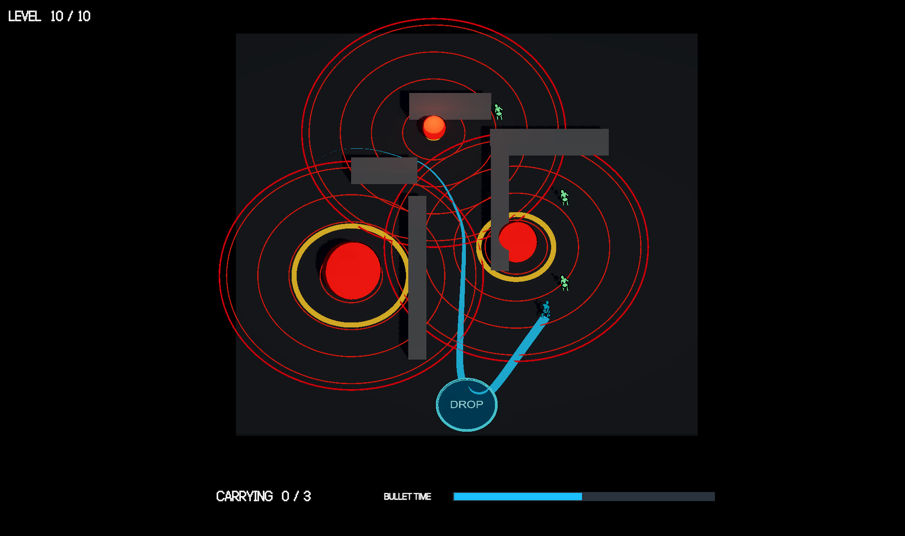

[**For the people 플레이하기**](https://haelime.itch.io/for-the-people)

### 요약
- 빠른 프로토타입 및 구현 능력으로 하루 만에 플레이 가능한 빌드 개발
- 세계에서 가장 제출 수가 많은 게임 잼에서 Creativity, Enjoyment 부문 상위 3% 성적 달성
- 

### 조작법

- 이동: 마우스 클릭이나 화면 터치 또는 옵션에서 `WASD` 모드 선택
- 불릿 타임 증폭: `Space`를 누르고 있기(모바일은 두 손가락 터치)
- 재시도: `R` 또는 결과 화면의 `RETRY`

GMTK Game Jam 2026의 주제인 **COUNTDOWN**을 폭발 시점을 읽고 시민을 구조하는 규칙으로 풀었습니다. Unity로 제작해 브라우저에서 바로 실행할 수 있는 HTML5 빌드로 공개했습니다.

## 카운트다운을 계획 가능한 구조 규칙으로 바꾸기

- **선택한 해결법:** 라운드를 `Planning → BulletTime → Won/Lost`로 나누고, 폭발 전에는 3초 간격의 충격파 윤곽선과 최종 범위를 표시했습니다. 시민은 `Waiting`, `Carried`, `Rescued`, `Lost` 상태로 관리해 충격파와 구조 지점이 상태를 바꾸도록 구성했습니다.
- **근거:** 여러 폭탄의 충격파는 서로 다른 시점에 퍼지므로 안전 경로도 시간에 따라 바뀝니다. 계획 단계에서 위험의 위치와 도달 시점을 먼저 보여 주고, 실행 단계의 피격과 구조 판정을 명시적인 상태 전이로 제한하면 같은 입력은 같은 결과로 이어집니다. 단계와 상태를 따로 관리하는 비용을 감수하는 대신, 플레이어가 실패 원인을 읽고 다음 경로를 다시 계획할 수 있게 했습니다.

## 느려진 세계에서도 조작 속도 유지하기

- **선택한 해결법:** 플레이어 이동·입력·UI·폭탄 점화 지연은 `Time.unscaledDeltaTime`으로 갱신하고, 충격파 확산은 `Time.deltaTime`으로 계산했습니다. 감속 비율이 바뀔 때 `Time.fixedDeltaTime`도 같은 비율로 조절했습니다.
- **근거:** 세계와 플레이어가 같은 시간축을 사용하면 불릿 타임이 위험뿐 아니라 조작 반응까지 늦춰 구조 경로를 수정하기 어려워집니다. 두 시간축을 분리하면 충격파는 느려져도 플레이어의 조작 속도는 유지되고, 물리 갱신 간격도 실제 시간 기준으로 급격히 달라지지 않습니다. 각 시스템이 사용할 시간축을 구분해야 하는 비용은 생기지만, 감속을 연출이 아니라 경로를 바꾸는 게임 규칙으로 유지했습니다.

## 하루 안에 10개 레벨 완성하기

- **선택한 해결법:** 계획 시간, 감속 비율, 폭발 반경, 폭탄·시민·구조 지점 배치를 `LevelLayout` 프리팹에 모으고, `CountdownGameDirector`가 이 데이터를 읽어 단계 전환과 라운드 생명주기를 조정하도록 했습니다. 편집기 생성 도구로 10개 레벨 프리팹을 만들었습니다.
- **근거:** 하루 안에 규칙과 콘텐츠를 함께 완성하려면 레벨을 늘릴 때마다 게임 진행 코드를 고치는 작업을 피해야 했습니다. 레벨 구성은 프리팹에 두고 실행 흐름은 하나의 조정자에 모아, 재시도할 때 현재 라운드를 정리한 뒤 같은 데이터로 다시 구성할 수 있게 했습니다. 조정자의 책임이 커지는 비용을 받아들이는 대신 제작 범위를 빠르게 닫았고, 기본 동작 검사로 레벨 순서, 프리팹 참조, 폭탄과 시민 수, 후반 레벨의 구조 가능 시간을 확인했습니다.

## 결과

| 부문  |     순위 |    점수 |
| --- | -----: | ----: |
| 창의성 |   326위 | 4.292 |
| 재미  |   382위 | 4.042 |
| 음향  | 1,220위 | 3.500 |
| 서사  | 2,813위 | 2.833 |
| 그래픽 | 2,890위 | 3.458 |

[GMTK 게임 잼 출품작 보기](https://itch.io/jam/gmtk-jam-2026/rate/4820527)
