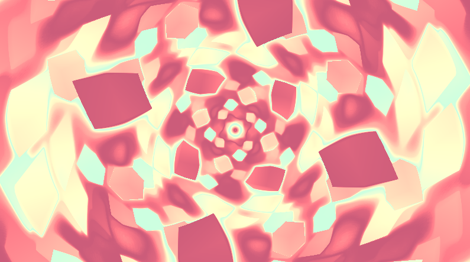

레이마칭으로 표면과 입체 효과를 구현한 셰이더 프로젝트입니다.

좋은 비주얼을 연출하고 실시간 렌더링을 위해 여러 셰이더들을 보고 연구했습니다.

3D 모델 아티스트와 협업해 작업했습니다.

[BOOTH에서 협업 작업 보기](https://fuwahebiya.booth.pm/items/7770402)

## Cloudy Crystal

  <iframe src="https://www.youtube.com/embed/sKYhIVCjzfU" title="Cloudy Crystal 셰이더 미리보기" allowfullscreen></iframe>

반투명 보석 내부에 움직이는 구름이 들어 있는 셰이더입니다.

유리 표면 렌더링과 볼륨 레이마칭을 결합했습니다.

### 표면 렌더링

- `GrabPass`와 법선 기반 UV 왜곡으로 배경 굴절 표현
- 시야각에 따라 색이 변하는 프리즘 정반사

### 내부 볼륨 구름

레이마칭은 객체의 로컬 좌표계에서 수행합니다. 객체가 이동하거나 회전해도 내부 구름이 메시에 고정됩니다.

- 노이즈로 변형한 Sphere SDF
- 3옥타브 FBM을 이용한 구름
- 반복 횟수로 근사한 그림자

## Cubestorm

GLSL 레이마칭으로 무한히 반복되는 큐브 터널을 렌더링합니다. 기하 메시 대신 박스 SDF와 좌표 변환만으로 장면을 정의했습니다.

### 핵심 기법

- **Ray march:** SDF가 반환한 거리만큼 전진
- **큐브 SDF:** 내부와 외부 거리를 모두 처리하는 부호 거리 함수
- **영역 반복:** `fract()`로 공간을 접어 하나의 큐브를 무한히 반복
- **공간 비틀기:** Ray 진행 거리에 따라 XY 좌표를 회전해 터널을 나선형으로 변형
- **팔레트:** 텍스처 없이 거리와 진행 횟수에 따른 절차적 색상 생성

최대 거리 이후에는 반복문을 조기 종료하고, 가능한 계산은 `min`, `max`, `step`으로 표현해 불필요한 분기를 줄였습니다.

[Shadertoy에서 Cubestorm 보기](https://www.shadertoy.com/view/lffGRj)
