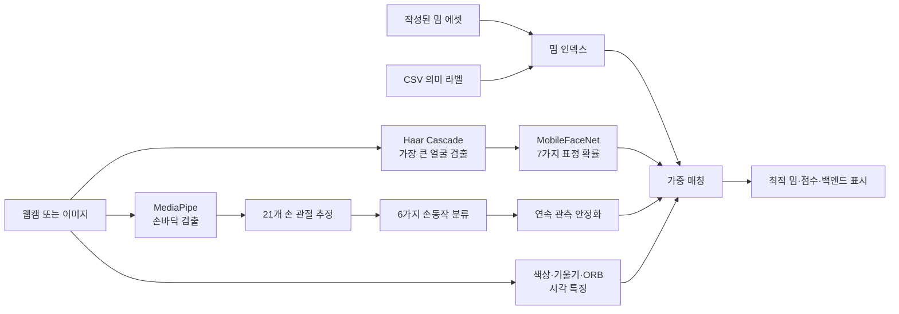

웹캠이나 사진에서 사람의 표정과 손동작을 인식하고, 의미와 생김새가 가장 가까운 고양이 밈을 찾아 보여 주는 Windows용 C++17 애플리케이션입니다. 얼굴·표정·손 검출 모델을 연결하는 데서 끝내지 않고, 프레임마다 흔들리는 추론 결과를 안정화하고 밈 에셋과 실행 파일을 함께 검증 가능한 형태로 배포하는 과정까지 구현했습니다.

[GitHub에서 소스 보기](https://github.com/haelime/cat-meme-detector)

## 한눈에 보기

| 항목 | 내용 |
| --- | --- |
| 담당 범위 | 애플리케이션 구조, OpenCV DNN 추론, 매칭 규칙, UI, 테스트, Windows 빌드·패키징 |
| 핵심 문제 | 서로 다른 신뢰도와 갱신 주기를 가진 표정·손동작·시각 특징을 안정적인 하나의 결과로 결합하는 것 |
| 핵심 결정 | 손 검출 여부에 따라 의미 신호의 가중치를 바꾸고, 손동작은 여러 번의 일관된 관측 뒤에만 매칭에 반영 |
| 결과 | 7가지 표정과 6가지 손동작, 정적 이미지·WEBP·GIF 밈을 지원하는 실행 가능한 데스크톱 도구 |
| 검증 | CPU DNN 추론과 매칭·안정화·GIF·에셋 계층을 검사하는 CTest 2개 통과 |
| 현재 상태 | Windows x64 v1.0.0 Release 패키지와 SHA-256 체크섬 생성 확인. 공개 GitHub Release는 아직 없음 |

이 프로젝트가 보여 주는 것은 다음 세 가지입니다.

- 여러 컴퓨터 비전 모델의 출력을 사용자에게 의미 있는 하나의 결과로 조합했습니다.
- 실시간 추론의 순간적인 오검출이 곧바로 UI를 바꾸지 않도록 시간축 상태를 별도로 설계했습니다.
- 소스 트리의 모델과 밈이 빌드·배포 결과에서 누락되거나 런타임 임시 시각물로 대체되지 않도록 회귀 테스트와 패키지 검증을 연결했습니다.

## 처리 흐름



얼굴은 표정 분석 영역을 정하는 데 사용하고, 손은 손바닥 검출 뒤 21개 관절을 추정해 동작으로 분류합니다. 입력 영상과 밈에서는 색상 히스토그램, 기울기 특징, ORB 기술자를 추출합니다. 최종 선택은 이 세 계열의 결과를 하나의 점수로 합산해 결정합니다.

## 닮은 이미지보다 상황에 맞는 밈 찾기

이미지 특징만 비교하면 같은 색이나 윤곽을 가진 밈이 높은 점수를 받을 수 있지만, 사용자가 웃거나 주먹을 드는 상황까지 설명하지는 못합니다. 반대로 표정 분류 하나만 사용하면 비슷한 의미의 후보들을 구분하기 어렵습니다. 그래서 매칭을 시각 유사도와 표정, 손동작의 결합으로 구성했습니다.

```cpp
if (handDetected) {
    return 0.10 * visual + 0.45 * expression + 0.45 * gesture;
}
return 0.15 * visual + 0.85 * expression;
```

손이 검출된 경우 표정과 손동작에 각각 45%, 시각 특징에 10%를 사용합니다. 손이 없다면 존재하지 않는 손동작 신호를 억지로 점수에 넣지 않고 표정 85%, 시각 특징 15%로 전환합니다. 입력에 손이 없고 `none`으로 명시된 밈이 존재하면 손동작이 붙은 밈을 후보에서 제외해, 시각 특징만 비슷한 손동작 밈이 선택되는 상황도 막았습니다.

이 가중치는 학습된 순위 모델이 아니라 현재 밈 모음에 적용한 명시적 규칙입니다. 결과를 추적하고 수정하기 쉽다는 장점이 있지만, 밈 수가 크게 늘어나면 별도의 평가 데이터로 가중치와 임계값을 다시 검증해야 합니다.

## 한 프레임의 오검출을 사용자 상태로 확정하지 않기

손 관절 추정은 조명, 움직임과 가림에 따라 짧은 순간 다른 동작을 반환할 수 있습니다. 매 프레임의 분류값을 바로 사용하면 선택된 밈이 빠르게 바뀌어 모델 정확도와 별개로 사용 경험이 불안정해집니다.

웹캠 분석은 5프레임마다 수행하고, 손동작은 동일한 결과가 4회 연속 관측된 뒤에만 확정합니다. 이미 확정된 손동작은 한 번 놓쳤다고 즉시 해제하지 않고, 두 번 연속 손을 찾지 못했을 때 `none`으로 돌아갑니다.

이 상태는 DNN 추론 클래스와 분리된 `HandGestureStabilizer`가 관리합니다. 모델은 현재 프레임의 관측만 반환하고, 시간에 걸친 확정과 해제 규칙은 독립적으로 테스트할 수 있습니다. 빠른 동작에 약간의 반응 지연이 생기는 비용을 감수하고, 일시적인 오검출이 곧바로 결과를 바꾸지 않는 쪽을 선택했습니다.

## 가속 경로가 실패해도 기능을 유지하기

세 ONNX 모델은 OpenCV DNN으로 실행합니다. CUDA 타깃을 사용할 수 있으면 FP16 추론을 우선하지만, 초기화 단계에서 사용할 수 있는 타깃이 없거나 실제 `forward` 호출에서 OpenCV 예외가 발생하면 세 네트워크를 CPU 백엔드로 다시 설정하고 같은 추론을 재시도합니다.

현재 사용 중인 백엔드는 결과 화면과 콘솔, 로그에 표시합니다. 가속이 꺼진 사실을 숨기지 않으면서도 CUDA 환경 차이 때문에 애플리케이션 전체가 중단되지 않게 한 경계입니다. CPU 경로는 실제 ONNX 모델을 로드해 추론하는 회귀 테스트로 확인했으며, CUDA 경로는 지원 코드와 전용 빌드 구성이 있지만 하드웨어별 성능 수치는 아직 제시하지 않습니다.

## 밈을 코드가 아니라 작성 가능한 에셋으로 관리하기

밈은 `assets/memes`에 파일로 추가하고, 표정과 손동작은 `meme_labels.csv`에서 보정할 수 있습니다. 작성된 CSV 값은 자동 분석보다 우선하며, 특히 `none`은 손동작이 없다는 의도적인 값으로 유지됩니다. 라벨이 없는 밈만 실행 시 표정·손 모델로 분석해 빈 의미 정보를 채웁니다.

정적 이미지뿐 아니라 WEBP와 GIF도 같은 데이터베이스에 들어갑니다. GIF는 첫 프레임으로 특징을 만들고, 선택된 뒤에는 `cv::imreadanimation`으로 읽은 프레임을 반복 재생합니다. 파일 형식 차이를 매칭 로직 밖의 이미지 로딩 계층에 모아 데이터베이스는 동일한 `Meme` 구조만 다루도록 했습니다.

런타임은 밈 디렉터리가 비어 있을 때 임시 이미지나 숨겨진 대체 시각물을 만들지 않고 오류로 거부합니다. 테스트에서는 작성된 에셋 계층의 존재, 빌드 결과와 원본 밈 목록의 일치, 빈 디렉터리에 시각물이 생성되지 않는지를 함께 검사합니다. 따라서 편집 시 보이는 에셋 구조와 실행 시 사용되는 구조가 달라지지 않습니다.

## 빌드에서 배포 파일까지 같은 검증을 유지하기

`cat_meme_core` 라이브러리에 인식과 매칭 로직을 두고 실행 파일과 테스트가 같은 구현을 사용합니다. PowerShell 빌드 스크립트는 OpenCV 5.0과 필요한 contrib 모듈을 구성하고, 애플리케이션을 빌드한 뒤 CTest를 실행합니다.

릴리즈 스크립트는 다음 작업을 자동화합니다.

1. CPU용 Release 빌드와 회귀 테스트 실행
2. 실행 파일, 모델, 밈, CSV, FFmpeg 플러그인과 VC++ 런타임 수집
3. 원본 에셋과 패키지 에셋의 경로 및 파일 크기 대조
4. 패키징된 실행 파일의 `--check-assets` 실행
5. ZIP 압축과 SHA-256 체크섬 생성

현재 로컬 빌드에서 `cat_meme_tests`와 `cat_meme_bundled_assets`가 모두 통과했고, `cat-meme-detector-v1.0.0-windows-x64.zip`과 체크섬 파일이 생성된 상태입니다. 단순히 개발 환경에서 실행되는 것을 넘어, 다른 PC로 전달할 파일에 필요한 모델과 런타임이 들어 있는지까지 실패 지점으로 취급했습니다.

## 검증한 범위

회귀 테스트는 다음 동작을 확인합니다.

- 동일 이미지와 변형 이미지 사이의 시각 특징 비교
- 표정·손동작·시각 특징의 가중치 계산
- 4회 확정·2회 해제 손동작 안정화
- 작성된 세 ONNX 모델의 CPU 로드 및 실제 추론
- 손바닥 검출 결과가 21개 관절과 손동작 분류로 이어지는지 확인
- CSV 라벨 우선순위와 라벨 없는 밈의 자동 분석
- JPG·PNG·WEBP·BMP·GIF 인덱싱과 GIF 반복 디코딩
- 원본과 빌드 결과의 밈 에셋 목록 일치
- 얼굴 검출 유무와 임계값에 따른 결과 표시 규칙
- 런타임 시각물 생성 fallback이 존재하지 않는지 확인

테스트는 모델의 일반적인 정확도를 증명하는 벤치마크는 아닙니다. 대신 모델 파일이 실제 백엔드에서 열리고, 각 단계의 출력이 다음 단계의 입력으로 전달되며, 작성된 에셋과 규칙이 배포 결과에서도 유지되는지를 검증합니다.

## 현재 한계와 다음 검증

- 가장 큰 얼굴 하나만 대상으로 하므로 다인 입력을 구분하지 않습니다.
- 고정 가중치와 40점 기본 임계값은 대규모 라벨 데이터로 최적화한 값이 아닙니다.
- 5프레임 간격 분석과 연속 관측 안정화는 흔들림을 줄이는 대신 빠른 동작의 반응을 늦춥니다.
- CUDA 빌드는 현재 compute capability 12.0을 대상으로 하며, 하드웨어별 지연 시간과 CPU 대비 성능 자료는 아직 없습니다.
- Windows x64 패키지는 로컬에서 생성·검증했지만 GitHub Releases를 통한 공개 배포는 아직 진행하지 않았습니다.

다음 단계에서는 표정·손동작별 검증 데이터셋을 분리해 오분류 행렬과 end-to-end 지연 시간을 측정하고, 현재 규칙 기반 가중치가 실제 사용자 입력에서도 적절한지 확인할 수 있습니다. 이 수치가 확보되면 CPU와 CUDA 경로의 선택 기준도 단순한 사용 가능 여부에서 측정된 지연 시간 기준으로 확장할 수 있습니다.
