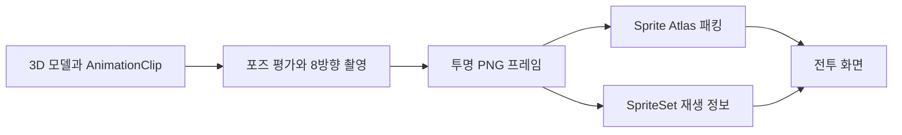

유명 모바일 게임의 클라이언트를 다시 개발해 보며 여러 의사 결정의 이유를 분석하고, 다른 개발 방법과는 어떤 차이가 있는지 알아보고자 했습니다.

대표적으로 살펴본 것은 **3D 모델을 여러 방향에서 미리 렌더한 뒤, 게임에서는 2D 이미지로 표시하는 pre-render 방식**입니다. 입체적으로 보이는 캐릭터를 매 프레임 3D로 그릴 필요가 있을까요? 전장을 바라보는 방향이 제한되어 있다면, 그 장면을 미리 계산해 두는 쪽이 모바일 환경에 더 적합할 수 있습니다.

이 프로젝트에서는 기존 3D 모델과 애니메이션을 8방향 PNG로 베이크하고, Sprite Atlas에 패킹해 전투 유닛으로 재생했습니다. 구현의 중심은 제작 도구 자체보다 **모바일에서 반복할 계산을 어디까지 제작 단계로 옮길 수 있는가**에 있습니다.

## 왜 Pre-render를 했는가

3D 모델을 사용해 캐릭터를 제작하는 것과, 게임 실행 중에 그 모델을 직접 렌더링하는 것은 별개의 선택입니다. Pre-render는 제작할 때 모델의 포즈, 재질과 조명을 계산해 이미지로 저장하고, 실행 중에는 필요한 이미지를 선택해 표시합니다. 입체적인 형태와 명암을 이미지에 남기면서도 원본 모델의 스키닝과 표면 표현을 매번 계산하는 비용을 줄일 수 있습니다.

Supercell의 GDC 발표에서도 초기 게임들이 pre-rendered 3D를 활용한 등각 시점으로 출발했다는 설명을 확인할 수 있습니다. 같은 발표는 모바일 렌더링에서 배터리와 열 방출이 제약이 된다는 점도 짚고 있습니다. 이 사례를 특정 게임의 내부 구현 전체에 대한 근거로 삼기보다, 제한된 시점과 모바일 하드웨어에 맞춘 렌더링 선택의 사례로 참고했습니다. ([GDC 2023 발표 자료](https://media.gdcvault.com/gdc2023/Slides/ModernizingRenderingAt_Heinapurola_Timo.pdf))

모바일에서는 화면에 유닛이 많아질수록 이동과 타깃 탐색, 전투 판정에 더해 캐릭터 표현 비용도 반복됩니다. 낮은 폴리곤 수는 정점 처리량을 줄이지만, 각 캐릭터의 애니메이션 포즈 평가와 스키닝까지 없애지는 않습니다. 화면에서 작게 보이는 유닛에 원본 3D 표현을 계속 계산할 가치가 있는지 따져볼 필요가 있었습니다.

60fps의 한 프레임은 약 16.7ms입니다. 이 시간 안에 게임 로직과 렌더링을 처리해야 하고, 오래 플레이한 뒤에도 발열로 성능이 크게 흔들리지 않아야 합니다. 전장을 내려다보는 이 프로젝트에서는 자유로운 카메라 회전보다 유닛의 방향과 공격 동작을 읽을 수 있는지가 중요하므로, 준비된 시점의 이미지를 재생하는 방식을 적용했습니다.

## 8방향 이미지로 동작을 표현하기

Unity Editor에서 AnimationClip의 시간을 지정해 포즈를 평가하고, 카메라를 45도 간격으로 배치해 같은 순간을 여덟 방향에서 촬영했습니다. 배경은 투명하게 저장하고, 동작과 방향, 프레임 순서를 SpriteSet에 기록했습니다.

  <figure style="margin:0;text-align:center"><figcaption>n</figcaption></figure>
  <figure style="margin:0;text-align:center"><figcaption>ne</figcaption></figure>
  <figure style="margin:0;text-align:center"><figcaption>e</figcaption></figure>
  <figure style="margin:0;text-align:center"><figcaption>se</figcaption></figure>
  <figure style="margin:0;text-align:center"><figcaption>s</figcaption></figure>
  <figure style="margin:0;text-align:center"><figcaption>sw</figcaption></figure>
  <figure style="margin:0;text-align:center"><figcaption>w</figcaption></figure>
  <figure style="margin:0;text-align:center"><figcaption>nw</figcaption></figure>

*Wizard 공격 동작의 같은 순간을 여덟 방향에서 촬영한 PNG.*

기본 출력은 256×256, 초당 12프레임이며 동작당 최대 프레임 수와 출력 해상도를 조절할 수 있도록 했습니다. 여기서 12fps는 캐릭터 이미지가 바뀌는 주기입니다. 유닛의 위치 갱신이나 게임 화면 전체를 12fps로 제한하는 설정은 아닙니다.

재생기는 현재 동작과 경과 시간, 바라보는 방향으로 프레임을 선택합니다. 게임에서는 `Idle`, `Move`, `Attack` 같은 공통 동작을 요청하고, SpriteSet이 캐릭터별 clip 이름과 연결합니다. 방향별 이미지 선택과 화면상의 이동을 분리해, 준비된 이미지 수 안에서 동작을 표현하도록 구성했습니다.

<figure style="margin:1.5rem 0">
  
  <figcaption>궁수 PNG 출력물을 탐색기에서 확인하는 과정. 제공된 화면 녹화 전체를 GIF로 변환.</figcaption>
</figure>

### 이미지 사이의 일관성 유지

프레임을 많이 만드는 것만으로는 자연스럽게 이어지는 동작을 얻기 어려웠습니다. 촬영 중 모델이 화면 밖에 있다고 판단되면 포즈가 갱신되지 않았고, 동작마다 카메라 크기를 맞추면 이동에서 공격으로 전환할 때 캐릭터 크기가 달라졌습니다.

포즈는 manual PlayableGraph로 평가하고, 화면 밖에서도 Animator와 skinned mesh가 갱신되도록 설정했습니다. 촬영 크기는 여러 동작과 방향의 최대 범위를 기준으로 통일하고 5% 여유를 두었습니다. 빈 PNG는 실패로 처리하며, 종료 시 변경한 카메라와 렌더러 설정을 복원해 다음 촬영에 영향을 남기지 않도록 했습니다.

## PNG 다음에는 Atlas가 필요했던 이유

Pre-render로 포즈 계산을 줄여도, 프레임마다 별도 텍스처를 사용하면 텍스처 전환 비용은 남습니다. 같은 Wizard 여러 개가 서로 다른 순간의 공격을 재생하는 경우도 마찬가지입니다. **여러 프레임을 같은 텍스처에서 읽을 수 있도록 Sprite Atlas V2를 연결했습니다.**

캐릭터별 `Sprites` 폴더를 atlas 입력으로 등록해 PNG가 추가되거나 재베이크되면 다시 패킹되도록 했습니다. 기존 SpriteSet의 참조는 유지하고, 게임에서는 Unity가 연결한 atlas의 스프라이트를 재생합니다. Atlas 생성과 패킹은 제작 단계에서 수행합니다.

<figure style="margin:1.5rem 0">
  

    
    
  

  <figcaption>Unity에서 실제 패킹된 Wizard atlas 2페이지를 PNG로 내보낸 결과. 이미지를 누르면 원본 크기로 확인 가능.</figcaption>
</figure>

Windows 대상 패킹 결과, Wizard의 PNG 1,216개는 2페이지로 묶였습니다. 적 Ram의 색상 변형까지 포함한 전체 8개 출력 폴더는 **PNG 6,888개에서 atlas 14페이지**가 되었습니다. 이 수치는 텍스처 구성의 변화입니다. 실제 draw call은 재질과 렌더 순서, atlas 페이지 경계에 따라 달라지므로 페이지 수와 같다고 볼 수는 없습니다.

모든 캐릭터를 하나로 묶기보다는 캐릭터별로 나누고, 카드 초상화는 전투 애니메이션 atlas에서 제외했습니다. 최대 페이지 크기는 4096으로 설정하고, tight packing과 4픽셀 여백을 사용했습니다. Read/Write와 mipmap을 끄고 Android/iOS에는 ASTC 6×6 압축을 설정해 모바일에서 사용할 텍스처 형식도 함께 관리했습니다.

### 연산을 줄이는 대신 늘어나는 데이터

Pre-render는 계산 비용을 이미지 데이터로 바꾸는 선택이기도 합니다. 동작과 방향, 해상도를 늘릴수록 저장하고 로드할 데이터가 많아집니다. Wizard 공격 한 동작만 해도 19프레임 × 8방향으로 152장입니다. 256×256 RGBA32 비압축, mipmap 없음으로 계산하면 38 MiB이며, 이는 저장량을 설명하기 위한 계산값입니다. 실제 메모리는 압축 형식과 atlas 배치, 로딩 범위에 따라 달라집니다.

| 선택 | 얻는 점 | 함께 관리할 비용 |
| --- | --- | --- |
| 실시간 3D | 자유로운 시점과 조명 변화 | 포즈 평가, 스키닝과 표면 렌더링 |
| Pre-render | 미리 계산한 형태와 명암 재사용 | 방향과 동작별 프레임 데이터 |
| Sprite Atlas | 같은 페이지의 텍스처 공유 | 패킹 여백과 페이지별 로딩 범위 |

따라서 pre-render가 모든 상황에서 유리한 것은 아닙니다. 이 프로젝트처럼 시점이 제한되고 캐릭터가 작게 표시되는 조건에서, 필요한 시각적 정보와 텍스처 비용 사이의 균형을 맞추는 것이 핵심입니다.

## 다른 구현 버전에서 적용한 결정론적 동기화

렌더링 비용과 함께 다룬 문제는 여러 기기에서 같은 전투를 진행하는 방법입니다. 별도 구현 버전에서는 **결정론적 락스텝과 고정 소수점 연산**을 적용했습니다. 매번 모든 유닛의 상태를 전송하는 대신, 같은 초기 상태에서 같은 입력을 같은 시뮬레이션 시점에 처리해 전투 결과를 맞추는 방식입니다.

이 구조에서는 유닛 수가 늘어도 모든 유닛의 위치를 계속 전송하는 방식과 다른 통신 비용 구조를 가질 수 있습니다. 대신 입력이 도착하기를 기다리는 지연과 각 기기의 계산 일치 여부를 관리해야 합니다. 고정 소수점은 기기와 실행 환경에 따른 수치 연산 차이를 통제하기 위한 선택이며, 결정론을 유지하려면 시간 간격뿐 아니라 입력 순서와 난수, 객체 처리 순서도 일관되어야 합니다. ([Deterministic Lockstep](https://gafferongames.com/post/deterministic_lockstep/))

결정론적 시뮬레이션은 초기 상태와 입력 기록으로 경기를 재생하거나, 누락된 구간을 빠르게 계산해 현재 시점에 도달하는 구조의 기반이 됩니다. 다만 특정 게임의 작은 리플레이 파일이나 재접속 시 배속 장면만으로 서버의 역할과 저장 형식을 확정할 수는 없습니다.

Pre-render는 화면 표현을 미리 계산하는 방식이고, 결정론은 전투 계산의 결과를 일치시키는 성질입니다. 두 선택은 목적이 다릅니다. 현재 소개한 Unity pre-render 버전과 별도 동기화 버전의 경험을 통해, 화면을 그리는 주기와 전투를 계산하는 규칙을 구분해서 바라볼 수 있었습니다.

## 전투 화면에 적용

베이크한 이미지와 재생 프리팹을 전투 유닛 7종에 연결했습니다. 아래 영상은 방향 전환과 이동, 공격을 sprite로 표현하고 카드 입력으로 유닛과 마법을 사용하는 플레이 데모입니다.

  <iframe src="https://www.youtube-nocookie.com/embed/ZiRJr_X7Xak?playsinline=1&amp;rel=0" title="Clasher2D 플레이 영상" width="360" height="640" loading="lazy" allow="encrypted-media; picture-in-picture; fullscreen" allowfullscreen style="display:block;width:100%;height:100%;border:0;border-radius:12px"></iframe>

[YouTube에서 플레이 영상 보기](https://www.youtube.com/shorts/ZiRJr_X7Xak)

현재 Unity 버전에서는 atlas 설정과 SpriteSet의 모든 프레임/방향 연결을 검사했습니다. 모바일의 실제 draw call, 메모리와 지속 플레이 후 프레임 시간은 아직 측정하지 않았으므로, 60fps 달성이나 성능 개선율을 결과로 제시하지는 않았습니다.

## 제작을 돕는 자동화

캐릭터가 늘어날 때 같은 촬영과 파일 연결을 반복하지 않도록 베이크를 배치 처리했습니다. 카드 초상화도 베이크 과정에서 얻은 정면 렌더를 상반신 중심으로 잘라 ComfyUI에 전달하고, 생성 결과를 게임 UI에 연결했습니다.

API 배치는 입력 업로드, 캐릭터별 prompt와 모델 설정 주입, 완료 확인과 다운로드를 처리합니다. 실패와 timeout을 검사하고, 출력 옆에 입력 경로와 prompt, 모델, seed 등 생성 조건을 JSON으로 남겼습니다. 자동화는 pre-render 에셋을 반복해서 제작하기 위한 보조 도구이며, 모바일 게임에서는 완성된 이미지만 사용합니다.

초상화 입력, 출력과 ComfyUI workflow 보기

  <figure style="margin:0"><figcaption>정면 렌더</figcaption></figure>
  <figure style="margin:0"><figcaption>자동 crop 입력</figcaption></figure>
  <figure style="margin:0"><figcaption>ComfyUI 출력</figcaption></figure>

<figure style="margin:1.5rem 0">
  
  <figcaption>기존 ComfyUI 초상화 workflow. 빨간 테두리는 캐릭터별 정규화 이미지를 전달하는 입력 노드. 이미지를 누르면 확대 가능.</figcaption>
</figure>

원본 3D 모델과 애니메이션은 기존 에셋을 사용했습니다. 초상화는 기존 모델과 LoRA를 활용한 생성 결과이며, workflow 화면은 Knight 입력 예시입니다.

