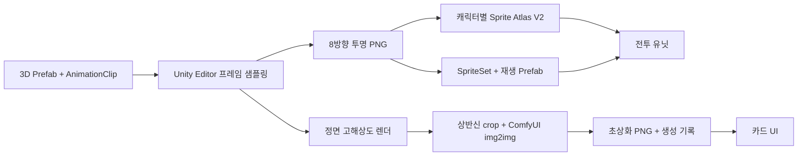

유명 모바일 게임을 다시 개발해 보며 여러 의사결정의 이유들을 알고 싶었습니다.

**3D 캐릭터를 전투용 8방향 sprite와 카드 초상화로 바꾸는 에셋 제작 파이프라인.** 촬영부터 재생 데이터, 프리팹 생성과 게임 연결까지 자동화했음.

원본 모델과 애니메이션은 기존 에셋을 사용함. 직접 구현한 범위는 Unity Editor 베이커, sprite 재생 구조, ComfyUI API 배치 처리와 게임 연결이며, 아래 이미지는 기존 파이프라인의 출력물임.

## 왜 미리 이미지로 만들었나

모바일 전투에서 여러 캐릭터를 동시에 표시할 때, 각 캐릭터의 3D 애니메이션 계산과 렌더링 비용을 줄이고자 했음. 전장을 내려다보는 제한된 시점을 활용해 **동작을 미리 촬영하고, 게임에서는 필요한 이미지를 선택**하도록 구성함. ([Unity 캐릭터 최적화 문서](https://docs.unity3d.com/6000.0/Documentation/Manual/ModelingOptimizedCharacters.html))

대신 자유로운 시점 변화와 실시간 조명 표현은 제한됨. 촬영할 이미지가 많아지므로 크기, 순서와 재생 정보를 일정하게 관리하는 도구도 함께 만들었음.

## 3D 원본에서 게임 에셋까지

Unity Editor에서 애니메이션의 각 포즈를 45도 간격으로 촬영해 8방향 투명 PNG로 저장함. 이미지는 재생 순서와 속도, 반복 여부를 담은 <code>SpriteSet</code>으로 묶고, 게임에서 사용할 재생 프리팹까지 생성했음. 여러 캐릭터의 반복 베이크는 PowerShell로 자동화함.

기본 출력은 **256×256, 초당 12프레임, 동작당 최대 48프레임**이며 조절 가능함. 12fps는 이미지 교체 주기이고, 유닛의 위치는 게임 프레임마다 갱신함.

  <figure style="margin:0;text-align:center"><figcaption>n</figcaption></figure>
  <figure style="margin:0;text-align:center"><figcaption>ne</figcaption></figure>
  <figure style="margin:0;text-align:center"><figcaption>e</figcaption></figure>
  <figure style="margin:0;text-align:center"><figcaption>se</figcaption></figure>
  <figure style="margin:0;text-align:center"><figcaption>s</figcaption></figure>
  <figure style="margin:0;text-align:center"><figcaption>sw</figcaption></figure>
  <figure style="margin:0;text-align:center"><figcaption>w</figcaption></figure>
  <figure style="margin:0;text-align:center"><figcaption>nw</figcaption></figure>

*Wizard 공격 동작의 같은 프레임을 여덟 방향에서 촬영한 PNG.*

<figure style="margin:1.5rem 0">
  
  <figcaption>궁수 PNG 출력물을 탐색기에서 확인하는 과정. 제공된 화면 녹화 전체를 GIF로 변환.</figcaption>
</figure>

## 개별 PNG를 캐릭터별 atlas로 패킹

PNG 베이크는 실행 중의 포즈 계산과 스키닝을 제작 단계로 옮기는 작업. 하지만 같은 캐릭터라도 서로 다른 프레임을 표시하면 별도 텍스처를 사용하므로, 이미지 선택만으로 texture 전환과 배칭 문제까지 해결되지는 않음. 베이크 출력에 **Sprite Atlas V2 패킹**을 연결해 여러 프레임이 같은 atlas 페이지를 사용하도록 구성했음.

각 캐릭터의 `Sprites` 폴더를 atlas 입력으로 등록하고, 새 캐릭터를 import하거나 전투 씬을 생성할 때 누락된 atlas를 만들도록 연결함. 폴더 안의 PNG가 추가되거나 재베이크되면 Unity가 다시 패킹하며, 기존 SpriteSet의 프레임 참조와 재생기는 그대로 사용. Atlas는 빌드에 포함하고 런타임에서 별도로 만들지 않음.

<figure style="margin:1.5rem 0">
  

    
    
  

  <figcaption>Unity에서 실제 패킹된 Wizard atlas 2페이지를 PNG로 내보낸 결과. 이미지를 누르면 원본 크기로 확인 가능.</figcaption>
</figure>

Unity 6000.6.0f1의 Windows 대상 패킹에서 Wizard의 PNG 1,216개가 2페이지로 묶였음. 전체는 적 Ram 색상 변형을 포함한 8개 출력 폴더의 PNG **6,888개 → atlas 14페이지**. 이는 텍스처 구성의 변화이며 draw call이 14개가 되었다는 의미는 아님. 재질과 렌더 순서에 따라 배칭이 나뉘고, 페이지가 다르면 texture 전환도 남음.

모든 캐릭터를 한 atlas에 모으지 않고 캐릭터별로 분리해 사용 범위에 맞춰 관리할 수 있도록 구성. 카드 초상화는 전투 애니메이션 atlas에서 제외했음. 페이지는 최대 4096, tight packing과 4픽셀 여백을 사용하고 회전은 비활성화. Read/Write와 mipmap을 끄고 Android/iOS에는 ASTC 6×6 압축을 설정했음. 페이지가 커지면 빈 공간이나 함께 로드되는 데이터도 늘 수 있으므로 페이지 수와 메모리는 함께 확인해야 함.

회귀 검사에서는 캐릭터별 atlas의 입력 폴더, 빌드 포함 여부, 모바일 압축 설정과 SpriteSet의 모든 프레임/방향 바인딩을 확인했음. 패킹 결과와 프레임 연결 검사는 통과했으며, 모바일 압축 품질과 실제 단말 성능은 별도 검증 범위.
## 베이크에서 해결한 문제

| 문제 | 해결 |
| --- | --- |
| 변경한 포즈가 촬영 결과에 반영되지 않음 | <code>PlayableGraph</code>로 시간을 지정해 포즈를 평가하고, 화면 밖에서도 Animator와 skinned mesh가 갱신되도록 설정 |
| 동작마다 캐릭터 크기가 달라짐 | 모든 동작과 방향의 최대 촬영 범위에 5% 여유를 더한 공통 카메라 크기 사용 |
| 빈 PNG가 정상 출력으로 넘어감 | 불투명 픽셀이 없는 결과를 실패로 처리 |
| 이전 촬영 설정이 다음 실행에 남음 | 종료 시 카메라, RenderTexture와 변경한 애니메이션/렌더러 설정 복원 |

## 같은 캐릭터로 카드 초상화 만들기

작은 카드에서 얼굴이 잘 보이도록 정면 렌더의 상반신을 자동으로 잘라 1024×1024 입력으로 정규화함. 이를 기존 ComfyUI workflow에 전달해 초상화를 만들었음.

  <figure style="margin:0"><figcaption>정면 렌더</figcaption></figure>
  <figure style="margin:0"><figcaption>자동 crop 입력</figcaption></figure>
  <figure style="margin:0"><figcaption>ComfyUI 출력</figcaption></figure>

### Workflow의 반복 입력을 API 배치로 연결

캐릭터마다 파일을 고르고 prompt와 저장 경로를 바꾸는 작업이 반복되므로, `comfy-generate-portraits.ps1`에서 입력 준비부터 결과 저장까지 처리하도록 구성함. 제공된 workflow 화면은 이 과정을 확인하는 노드 그래프이며, Knight 입력을 예시로 보여줌.

<figure style="margin:1.5rem 0">
  
  <figcaption>기존 ComfyUI 초상화 workflow. 빨간 테두리는 캐릭터별 정규화 이미지를 전달하는 입력 노드. 이미지를 누르면 확대 가능.</figcaption>
</figure>

스크립트는 정면 렌더를 crop하고 `/upload/image`로 업로드한 뒤, API 그래프에 이미지 경로와 checkpoint, LoRA, 캐릭터별 설명, seed와 출력 경로를 주입함. 공통 화풍 prompt에 Wizard의 파란 모자, 흰 수염과 로브 같은 특징을 더해 캐릭터를 구분하도록 구성. 입력 이미지는 VAE로 인코딩하고, prompt 조건과 함께 샘플링한 결과를 디코딩해 초상화 PNG로 저장함.

`/prompt` 요청에서 받은 ID로 `/history`의 완료 상태를 확인하고 `/view`에서 결과를 내려받음. 실행 전 필요한 노드와 모델을 검사하며, 요청 실패, timeout과 출력 이미지가 없는 경우를 오류로 처리해 불완전한 결과가 정상 출력처럼 넘어가지 않도록 했음.

### 결과와 생성 조건을 함께 보관

완성된 PNG 옆에 원본과 정규화 입력 경로, 실제 prompt, 모델, LoRA, seed, sampler, steps와 denoise를 provenance JSON으로 저장함. Wizard의 기존 기록에서는 1024 해상도, 32 steps, denoise 0.6을 확인할 수 있음. 같은 결과의 생성 조건을 추적하고 다시 시도할 기준을 남긴 구성.

자동화한 범위는 입력 가공과 workflow 실행, 결과 수집과 기록. 원본 3D 에셋은 기존 에셋을 사용했고 초상화는 기존 모델과 LoRA를 활용한 생성 결과이며, 캐릭터 식별성과 카드 크기에서의 가독성은 출력 후 시각 검토가 필요함.

이미지 생성은 개발 환경에서 수행하며, 모바일 게임은 완성된 초상화만 사용함.

## 전투 유닛과 카드에 적용

게임은 <code>Idle</code>, <code>Move</code>, <code>Attack</code> 같은 공통 동작을 요청하고, SpriteSet이 캐릭터별 애니메이션과 연결함. 재생기는 현재 방향과 시간에 맞는 이미지를 선택하며, 공격이나 피격이 끝나면 이동 또는 대기 동작으로 복귀함.

생성한 프리팹을 **전투 유닛 7종**에, 초상화를 카드 UI에 연결했음. 방향별 이미지와 재생 데이터, 프리팹 참조를 확인하고 실제 카드 입력 경로로 한 경기를 진행한 기록을 남김. 아래 제공된 영상은 에셋을 게임에 적용한 플레이 데모임.

  <iframe src="https://www.youtube-nocookie.com/embed/ZiRJr_X7Xak?playsinline=1&amp;rel=0" title="Clasher2D 플레이 영상" width="360" height="640" loading="lazy" allow="encrypted-media; picture-in-picture; fullscreen" allowfullscreen style="display:block;width:100%;height:100%;border:0;border-radius:12px"></iframe>

[YouTube에서 플레이 영상 보기](https://www.youtube.com/shorts/ZiRJr_X7Xak)

## 남은 비용과 검증

3D 계산을 이미지 선택으로 바꾸면서 **텍스처 메모리와 그리기 비용**을 관리해야 함. Wizard 공격은 19프레임 × 8방향으로 152장이며, 256×256 RGBA32 비압축, mipmap 없음으로 계산하면 한 동작에 38 MiB가 필요함. 실제 메모리는 압축 형식과 로딩 범위에 따라 달라지고, PNG 파일 크기와도 다름.

Sprite Atlas V2와 모바일 ASTC 압축 설정까지 연결했으며, atlas 페이지 사이의 texture 전환과 그림자/이펙트의 overdraw는 남음. Addressables를 통한 경기별 로딩 범위 제어는 아직 적용하지 않았음. ([Unity Sprite Atlas 문서](https://docs.unity3d.com/6000.0/Documentation/Manual/sprite/atlas/atlas-landing.html))

베이크 결과의 게임 연결까지 확인했으며, **모바일 성능 개선 폭과 제작 시간 절감량은 아직 측정하지 않았음.** 같은 단말과 전투 조건에서 3D 방식과 비교하고, 지속 플레이 후 프레임 시간과 메모리를 측정할 예정임. ([Unity 모바일 프로파일링 가이드](https://unity.com/how-to/best-practices-for-profiling-game-performance))
