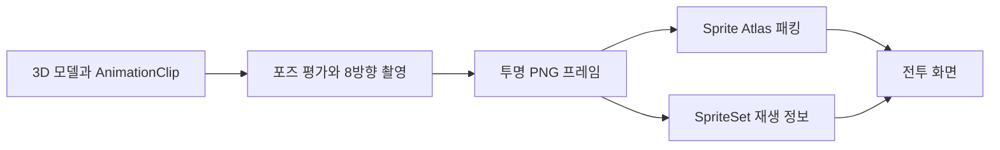

유명 모바일 게임의 클라이언트를 다시 개발하며, 제한된 하드웨어에서 최적의 성능을 위해선 어떤 기술적 선택이 필요한지 살펴보고자 했습니다

그중 중점적으로 구현한 것은 3D 모델의 애니메이션을 미리 렌더링하고, 실행 중에는 그 결과를 스프라이트로 재생하는 pre-render 방식입니다.

이 프로젝트에서는 애니메이션을 8방향 PNG로 베이크하고 Sprite Atlas에 패킹했습니다. Pre-render로 캐릭터 표현에 필요한 런타임 연산을 줄이고, atlas로 여러 프레임이 텍스처를 공유하도록 구성했습니다.

---
## 왜 Pre-render를 했는가

3D 모델을 사용해 캐릭터를 제작하는 것과, 게임 실행 중에 그 모델을 직접 렌더링하는 것은 별개의 선택입니다. Pre-render는 제작할 때 모델의 포즈, 재질과 조명을 계산해 이미지로 저장하고, 실행 중에는 필요한 이미지를 선택해 표시합니다. 입체적인 형태와 명암을 이미지에 남기면서도 원본 모델의 mesh와 material 등을 매번 계산하는 비용을 줄일 수 있습니다.

<figure style="margin:1.5rem 0;text-align:center">
  
  <figcaption>Pre-render 사례로 참고한 스타크래프트의 울라리</figcaption>
</figure>

모바일에서는 화면에 유닛이 많아질수록 이동과 타깃 탐색, 전투 판정에 더해 캐릭터 표현 비용도 반복됩니다. Low-poly로 처리하면 연산량을 줄일 수 있지만, 각 캐릭터의 애니메이션과 셰이더 계산 비용까지 줄어들진 않습니다. 화면에서 작게 보이는 유닛에 원본 3D 표현을 계속 계산할 가치가 있는지 따져볼 필요가 있었습니다.

60fps의 한 프레임은 약 16.7ms입니다. 이 시간 안에 게임 로직과 렌더링을 처리해야 하고, 오래 플레이한 뒤에도 발열로 성능이 낮아지는 건 피하고 싶었습니다.

이 프로젝트에서는 고정된 시점을 사용하는데다, 유닛의 방향과 공격 동작을 읽을 수 있는지가 중요하므로, pre-render 방식을 적용했습니다.

[Supercell의 GDC 발표 영상](https://www.youtube.com/watch?v=Fwh-fzhREOU)과 [자료](https://media.gdcvault.com/gdc2023/Slides/ModernizingRenderingAt_Heinapurola_Timo.pdf)를 참고하시면 좋습니다.

---
## 8방향 이미지로 동작을 표현하기

Unity Editor에서 AnimationClip의 시간을 지정해 포즈를 평가하고, 카메라를 45도 간격으로 배치해 같은 순간을 여덟 방향에서 촬영했습니다. 배경은 투명하게 저장하고, 동작과 방향, 프레임 순서를 SpriteSet에 기록했습니다.

  <figure style="margin:0;text-align:center"><figcaption>n</figcaption></figure>
  <figure style="margin:0;text-align:center"><figcaption>ne</figcaption></figure>
  <figure style="margin:0;text-align:center"><figcaption>e</figcaption></figure>
  <figure style="margin:0;text-align:center"><figcaption>se</figcaption></figure>
  <figure style="margin:0;text-align:center"><figcaption>s</figcaption></figure>
  <figure style="margin:0;text-align:center"><figcaption>sw</figcaption></figure>
  <figure style="margin:0;text-align:center"><figcaption>w</figcaption></figure>
  <figure style="margin:0;text-align:center"><figcaption>nw</figcaption></figure>

*Wizard 공격 동작의 같은 순간을 여덟 방향에서 촬영한 PNG.*

기본 출력은 256×256, 초당 12프레임이며 동작당 최대 프레임 수와 출력 해상도를 조절할 수 있도록 했습니다.

 `Idle`, `Move`, `Attack`, `Death` 같은 기본적인 동작들만 구웠습니다.
<figure style="margin:1.5rem 0">
  
  <figcaption>궁수 PNG 출력물을 탐색기에서 확인하는 과정. 제공된 화면 녹화 전체를 GIF로 변환.</figcaption>
</figure>

## Atlas packing

Pre-render로 연산을 줄여도, 프레임마다 별도 텍스처를 사용하면 텍스처 전환 비용은 남습니다. 같은 Wizard 여러 개가 서로 다른 순간의 공격을 재생하는 경우도 마찬가지입니다. 여러 프레임을 같은 텍스처에서 읽을 수 있도록 Sprite Atlas V2를 연결했습니다.

캐릭터별 `Sprites` 폴더를 atlas 입력으로 등록해 PNG가 추가되거나 재베이크되면 다시 패킹되도록 했습니다. 기존 SpriteSet의 참조는 유지하고, 게임에서는 Unity가 연결한 atlas의 스프라이트를 재생합니다. Atlas 생성과 패킹은 제작 단계에서 수행합니다.

<figure style="margin:1.5rem 0">
  

    
  

  <figcaption>실제 패킹된 Wizard atlas. 이미지를 누르면 원본 크기로 확인 가능.</figcaption>
</figure>

Windows 대상 패킹 결과, Wizard의 PNG 1,216개는 2페이지로 묶였습니다. 하나로 줄였다면 더 좋았겠지만, 아무튼 전체 8개 출력 폴더는 **PNG 6,888개에서 atlas 14페이지**가 되었습니다.

### 유의해야 할 점

많은 최적화 기법이 그렇듯, pre-render도 메모리와 저장 공간을 더 사용하는 대신 실행 중의 연산을 줄이는 선택입니다.

동작과 방향, 해상도를 늘릴수록 저장하고 로드할 데이터가 많아집니다. Wizard 공격 한 동작만 해도 19프레임 × 8방향으로 152장입니다. 256×256 RGBA32 비압축, mipmap 없음으로 계산하면 38 MiB이며, 이는 저장량을 설명하기 위한 계산값입니다. 실제 메모리는 압축 형식과 atlas 배치, 로딩 범위에 따라 달라집니다.

| 선택           | 얻는 점              | 함께 관리할 비용          |
| ------------ | ----------------- | ------------------ |
| 실시간 3D       | 자유로운 시점과 조명 변화    | 포즈 평가, 스키닝과 표면 렌더링 |
| Pre-render   | 미리 계산한 형태와 명암 재사용 | 방향과 동작별 프레임 데이터    |
| Sprite Atlas | 같은 페이지의 텍스처 공유    | 패킹 여백과 페이지별 로딩 범위  |

즉, pre-render가 모든 상황에서 유리한 것은 아닙니다. 이 프로젝트처럼 시점이 제한되고 캐릭터가 작게 표시되는 조건에서, 필요한 시각적 정보와 텍스처 비용 사이의 균형을 맞추는 것이 핵심입니다.

## 결정론적 동기화

렌더링 비용과 함께 다룬 문제는 여러 기기에서 같은 전투를 진행하는 방법입니다. 여기서는 **결정론적 Lockstep과 Fixed-point**을 적용했습니다. 매번 모든 유닛의 상태를 전송하는 대신, 같은 초기 상태에서 같은 입력을 같은 시뮬레이션 시점에 처리해 전투 결과를 맞추는 방식입니다.

이 구조에서는 유닛 수가 늘어도 모든 유닛의 위치를 계속 전송하는 방식과 다른 통신 비용 구조를 가질 수 있습니다. 대신 입력이 도착하기를 기다리는 지연과 각 기기의 계산 일치 여부를 관리해야 합니다. 고정 소수점은 기기와 실행 환경에 따른 수치 연산 차이를 통제하기 위한 선택이며, 결정론을 유지하려면 시간 간격뿐 아니라 입력 순서와 난수, 객체 처리 순서도 일관되어야 합니다. [Deterministic Lockstep](https://gafferongames.com/post/deterministic_lockstep/)

결정론적 시뮬레이션은 초기 상태와 입력 기록으로 경기를 재생하거나, 누락된 구간을 빠르게 계산해 현재 시점에 도달하는 구조의 기반이 됩니다.

## 전투 화면에 적용

베이크한 이미지와 재생 프리팹을 전투 유닛 7종에 연결했습니다. 아래 영상은 방향 전환과 이동, 공격을 sprite로 표현하고 카드 입력으로 유닛과 마법을 사용하는 플레이 데모입니다.

  <iframe src="https://www.youtube-nocookie.com/embed/ZiRJr_X7Xak?playsinline=1&amp;rel=0" title="Clasher2D 플레이 영상" width="360" height="640" loading="lazy" allow="encrypted-media; picture-in-picture; fullscreen" allowfullscreen style="display:block;width:100%;height:100%;border:0;border-radius:12px"></iframe>

[YouTube에서 플레이 영상 보기](https://www.youtube.com/shorts/ZiRJr_X7Xak)

## 제작을 돕는 자동화

캐릭터가 늘어날 때 같은 촬영과 파일 연결을 반복하지 않도록 베이크를 배치 처리했습니다. 카드 초상화도 베이크 과정에서 얻은 정면 렌더를 상반신 중심으로 잘라 ComfyUI에 전달하고, 생성 결과를 게임 UI에 연결했습니다.

API 배치는 입력 업로드, 캐릭터별 prompt와 모델 설정 주입, 완료 확인과 다운로드를 처리합니다. 실패와 timeout을 검사하고, 출력 옆에 입력 경로와 prompt, 모델, seed 등 생성 조건을 JSON으로 남겼습니다. 자동화는 pre-render 에셋을 반복해서 제작하기 위한 보조 도구이며, 모바일 게임에서는 완성된 이미지만 사용합니다.

### 초상화 입력, 출력과 ComfyUI workflow

  <figure style="margin:0"><figcaption>정면 렌더</figcaption></figure>
  <figure style="margin:0"><figcaption>자동 crop 입력</figcaption></figure>
  <figure style="margin:0"><figcaption>ComfyUI 출력</figcaption></figure>

<figure style="margin:1.5rem 0">
  
  <figcaption>기존 ComfyUI 초상화 workflow. 빨간 테두리는 캐릭터별 정규화 이미지를 전달하는 입력 노드. 이미지를 누르면 확대 가능.</figcaption>
</figure>

원본 3D 모델과 애니메이션은 기존 에셋을 사용했습니다. 초상화는 기존 모델과 LoRA를 활용한 생성 결과이며, workflow 화면은 Knight 입력 예시입니다.
