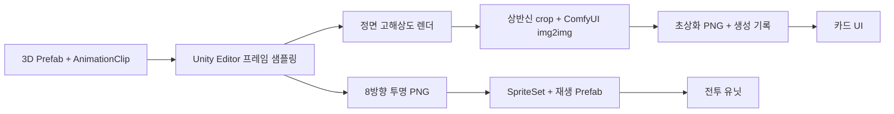

Clashers의 모바일 전투에 사용할 캐릭터 에셋을 만들기 위해 **3D Prefab과 AnimationClip을 입력받아 8방향 sprite, 재생 데이터, 전투 프리팹과 카드 초상화로 연결하는 제작 파이프라인**을 구현함.

제한된 시점에서 작게 표시되는 캐릭터의 포즈와 표면 표현을 제작 단계에서 미리 계산하고, 반복되는 촬영, 파일 연결과 초상화 요청을 자동화했음. 캐릭터가 바뀌어도 같은 출력 규칙으로 게임에 연결할 수 있도록 만드는 것이 핵심 작업이었음.

원본 모델과 애니메이션은 기존 에셋을 사용했으며, 구현 범위는 Unity Editor 베이커, SpriteSet과 재생 프리팹 생성, ComfyUI API 배치 처리 및 게임 연결. 아래 이미지는 기존 파이프라인에서 얻은 출력물임.

## 모바일 전투에 맞춰 제작 단계로 옮긴 작업

전장을 내려다보는 제한된 시점에서 여러 캐릭터가 동시에 움직이는 게임을 대상으로 했음. 캐릭터가 화면에서 작게 보이더라도 각 인스턴스의 포즈 평가, bone transform 갱신과 skinned mesh 변형은 남으므로, 폴리곤 수와 함께 애니메이션 실행 경로를 검토했음. ([Unity 캐릭터 최적화 문서](https://docs.unity3d.com/6000.0/Documentation/Manual/ModelingOptimizedCharacters.html))

이 시점 제약을 활용해 각 동작을 여덟 방향에서 촬영하고, 실행 중에는 현재 동작과 방향에 맞는 PNG를 선택하도록 구성함. 포즈와 표면 표현의 계산을 제작 단계로 옮기는 대신, 준비된 방향과 프레임 안에서 캐릭터를 표현하는 선택임.

캐릭터 하나에서도 동작, 프레임과 방향을 조합하면 다수의 이미지가 필요함. 따라서 PNG 촬영에 더해 크기와 순서의 일관성, 재생 정보 보존, 카드용 이미지 준비까지 이어지는 제작 도구가 필요했음.

| 구분 | 원본 3D 캐릭터 재생 | PNG sprite actor 재생 |
| --- | --- | --- |
| 동작 표현 | 실행 중 포즈 평가와 mesh 변형 | 제작 단계에서 계산한 프레임 선택 |
| 표면 표현 | 원본 geometry와 재질 렌더링 | 촬영한 표면 표현을 texture에서 조회 |
| 방향 전환 | 현재 시점에서 모델을 다시 그릴 수 있음 | 준비된 8방향 중 하나를 선택 |
| 관리할 비용 | bone, vertex와 재질 구성이 중요함 | texture memory, 투명 픽셀과 배치 구성이 중요함 |

동적인 조명에 대한 원본 3D 표면의 반응과 연속적인 시점 변화는 제한됨. 동일 캐릭터의 인스턴스는 PNG와 SpriteSet을 공유하며, 표현에 필요한 개별 상태는 동작, 방향과 재생 시간으로 관리함.

## 3D 원본에서 두 종류의 게임 에셋으로

하나의 3D 원본에서 전투용 8방향 이미지와 카드용 정면 렌더를 얻도록 입력을 공유함. 전투 경로는 PNG를 SpriteSet과 재생 프리팹으로 묶고, 초상화 경로는 정면 렌더를 가공해 ComfyUI에 전달함.

### 동작과 방향을 일정한 규칙으로 샘플링

Unity Editor의 별도 Preview Scene에 촬영용 rig와 원본 Prefab을 배치하고, clip의 특정 시점에서 얻은 포즈를 45도 간격으로 여덟 번 렌더함. 이 과정을 프레임별로 반복해 `캐릭터_동작_방향_프레임.png` 형태로 저장함. `RenderTexture`의 RGBA 결과를 PNG로 인코딩해 배경의 투명도를 유지했음.

PNG를 Unity Sprite로 import한 뒤 frame 우선, direction 후순서로 `EightWaySpriteSet`에 연결함. 캐릭터별 반복 실행은 `bake-all-eightway.ps1`이 처리하며, 재생에 필요한 정보를 출력물과 함께 남겨 파일 이름에서 동작과 순서를 다시 추정하지 않도록 구성함.

| 출력물 | 저장하는 내용 | 다음 단계에서 사용하는 곳 |
| --- | --- | --- |
| 8방향 PNG | 동작별 포즈와 촬영 방향, 투명 배경 | Unity Sprite import |
| SpriteSet과 metadata | 프레임 배열, 원본 clip, 입력/출력 구간, 재생 속도와 loop 여부 | 동작과 방향에 맞는 프레임 조회 |
| 재생 프리팹 | SpriteRenderer와 재생 데이터 연결 | 전투 유닛의 표현 |
| 정면 고해상도 렌더 | 같은 캐릭터의 초상화 입력 이미지 | 상반신 crop과 ComfyUI 배치 처리 |

  <figure style="margin:0;text-align:center"><figcaption>n</figcaption></figure>
  <figure style="margin:0;text-align:center"><figcaption>ne</figcaption></figure>
  <figure style="margin:0;text-align:center"><figcaption>e</figcaption></figure>
  <figure style="margin:0;text-align:center"><figcaption>se</figcaption></figure>
  <figure style="margin:0;text-align:center"><figcaption>s</figcaption></figure>
  <figure style="margin:0;text-align:center"><figcaption>sw</figcaption></figure>
  <figure style="margin:0;text-align:center"><figcaption>w</figcaption></figure>
  <figure style="margin:0;text-align:center"><figcaption>nw</figcaption></figure>

*할버더 `Attack_A`의 같은 프레임을 여덟 방향에서 촬영한 실제 PNG 출력. 방향 이름은 베이크 카메라의 시점.*

<figure style="margin:1.5rem 0">
  
  <figcaption>궁수 PNG 출력물을 탐색기에서 확인하는 과정. 제공된 화면 녹화 전체를 GIF로 변환.</figcaption>
</figure>

### 출력 해상도와 샘플 수를 제작 설정으로 관리

기본 출력은 256×256, 12fps, clip당 최대 48프레임으로 설정함. 모바일 전장의 작은 캐릭터에 필요한 실루엣과 공격 동작을 읽을 수 있는지 확인하면서, 해상도와 샘플 수를 조절할 수 있게 한 구성임. 고해상도 출력이 항상 유리한 것은 아니며, 가로와 세로를 각각 두 배로 올리면 프레임당 픽셀 수는 네 배가 됨.

여기서 12fps는 캐릭터 이미지가 바뀌는 시간 간격이며 게임 전체를 12fps로 실행한다는 뜻이 아님. 유닛의 위치는 게임 frame마다 갱신하고, sprite는 재생 시간에 해당하는 프레임을 선택함. 8방향 역시 연속적인 회전을 이미지 선택으로 바꾸는 결정이므로, 방향 경계에서의 전환과 빠른 공격의 가독성을 확인해야 함.

## 반복 베이크에서 포즈와 크기를 유지하기

많은 파일을 생성해도 포즈가 갱신되지 않거나 동작마다 크기가 달라지면 게임에서 사용할 수 없음. 촬영 단계에서 포즈 평가와 카메라 기준을 맞추고, 빈 결과는 실패로 처리했음.

### 설정한 포즈가 PNG에 반영되지 않는 문제

포즈를 샘플링해도 offscreen 상태의 skinned mesh가 갱신되지 않으면 변경한 팔 동작이 촬영 결과에 반영되지 않는 문제가 있었음. Animator가 있는 모델은 manual `PlayableGraph`에서 clip의 시간을 지정해 평가하고, `AlwaysAnimate`, `updateWhenOffscreen`, `forceMatrixRecalculationPerRender`를 설정해 포즈와 렌더의 갱신을 맞춤. 공격 팔의 가독성 보정도 샘플링 이후에 적용해 최종 포즈가 이미지에 포함되도록 구성함.

### 동작이 바뀔 때 캐릭터 크기가 달라지는 문제

카메라 크기를 동작마다 맞추면 같은 캐릭터가 공격할 때 커지고 이동할 때 작아 보일 수 있었음. 동작과 방향에 따른 projected bounds를 측정한 뒤, 가장 큰 bounds를 기준으로 5% 여유를 둔 공통 orthographic size를 사용함. 이를 통해 무기까지 촬영 범위에 포함하면서 동작 전환 시 크기를 유지하도록 구성함.

### 실패한 촬영과 다음 실행의 상태 분리

촬영 결과에 불투명한 픽셀이 하나도 없으면 실패로 처리해 빈 PNG가 정상 결과로 넘어가지 않게 함. 종료 시에는 카메라 target, 활성 RenderTexture와 변경한 Animator 및 renderer 설정을 복원해 다음 베이크에 상태가 남지 않도록 처리함.

## 같은 원본에서 카드 초상화 제작 자동화

전투용 sprite 다음에는 카드에서 캐릭터를 구분할 초상화가 필요했음. 베이크 과정의 정면 렌더를 재사용하고, 입력 준비부터 요청, 완료 확인과 결과 기록까지 연결했음.

### 정면 렌더를 초상화 입력으로 정규화

모바일의 카드 슬롯에서는 캐릭터를 빠르게 구분해야 하지만 전신 sprite를 축소하면 얼굴이 작아지는 문제가 있었음. 베이크 시 생성한 정면 고해상도 렌더에서 alpha bounds를 찾고, 상반신을 중심으로 정사각형 crop을 만들어 1024×1024 입력으로 정규화함.

  <figure style="margin:0"><figcaption>정면 렌더</figcaption></figure>
  <figure style="margin:0"><figcaption>자동 crop 입력</figcaption></figure>
  <figure style="margin:0"><figcaption>ComfyUI 출력</figcaption></figure>

*기존 파이프라인의 정면 렌더 → 자동 crop 입력 → ComfyUI 초상화 출력*

### 캐릭터별 요청과 생성 조건을 함께 관리

`comfy-generate-portraits.ps1`은 표준 API workflow에 입력 이미지, 공통 prompt, 캐릭터별 설명, checkpoint, LoRA와 seed를 주입함. `/upload/image`로 입력을 전송하고 `/prompt`로 작업을 제출한 뒤, `/history/{promptId}`에서 완료를 확인하고 `/view`로 결과를 내려받도록 구현함. 캐릭터마다 crop, 업로드와 workflow 설정을 반복하는 부분을 자동화한 작업임.

여러 캐릭터의 배치 처리를 위해 실행 전 노드와 모델 구성을 검사하고, 요청별 실패 상태와 timeout을 처리함. 출력 PNG 옆에는 원본과 정규화 입력, 실제 prompt, 모델 이름, seed, sampler, steps와 denoise를 provenance JSON으로 기록함. 할버더의 기존 기록에서 1024 해상도, 32 steps와 denoise 0.6을 확인할 수 있으며, 파일만 남겼을 때와 달리 생성 조건을 다시 추적할 수 있음.

ComfyUI 추론은 개발 환경에서 수행하고 게임에는 완성된 초상화를 연결함. 따라서 모바일 게임이 모델을 실행하거나 생성 완료를 기다릴 필요가 없도록 구성했으며, 단말에서는 최종 이미지의 해상도와 압축을 관리하면 됨. 생성 원본의 시각 검토와 카드 표시 크기에 맞춘 최종 texture 설정은 API 자동화와 구분되는 작업임.

## 생성한 에셋을 전투 유닛과 카드에 연결하기

게임 코드는 원본 clip 이름 대신 `Idle`, `Move`, `Attack`, `Hit`, `Death` 같은 action을 요청하도록 구성함. 캐릭터마다 다른 `Walk`, `Run`, `Attack_A` 등의 이름은 SpriteSet의 action binding에서 연결함.

`EightWaySpriteAnimator`는 방향 벡터를 45도 간격으로 나누고, 베이크 카메라 시점과 캐릭터 진행 방향을 맞추기 위해 기본 180도 보정을 적용함. 프레임은 `frameIndex * 8 + directionIndex`로 조회하며, 공격과 피격 같은 one-shot 동작이 끝나면 지정한 이동 또는 대기 동작으로 복귀하도록 구현함.

생성한 SpriteRenderer 프리팹을 전투 유닛 7종에 연결하고, 실루엣 그림자는 `LateUpdate`에서 몸체의 현재 sprite와 flip을 복사하도록 구성함. 초상화는 카드 UI에 연결했으며, 카드로 유닛을 배치하면 소환 대기, 이동, 공격과 사망까지 같은 재생 경로를 사용함.

이 연결로 베이커가 만든 프레임 순서와 action binding이 실제 전투 상태에서도 맞는지 확인할 수 있었음. 아래 제공된 플레이 영상은 완성된 에셋이 전투와 UI에서 사용되는 적용 사례임.

  <iframe src="https://www.youtube-nocookie.com/embed/ZiRJr_X7Xak?playsinline=1&amp;rel=0" title="Clasher2D 플레이 영상" width="360" height="640" loading="lazy" allow="encrypted-media; picture-in-picture; fullscreen" allowfullscreen style="display:block;width:100%;height:100%;border:0;border-radius:12px"></iframe>

[YouTube에서 플레이 영상 보기](https://www.youtube.com/shorts/ZiRJr_X7Xak)

## 모바일용 출력에서 남는 메모리와 렌더링 비용

PNG 베이크는 실행 중 계산하던 정보를 texture에 저장하는 선택이므로, 모바일 최적화에서는 저장량과 렌더링 비용도 함께 관리해야 함.

할버더의 `Attack_A`는 실제 출력 기준 19프레임과 8방향으로 PNG 152장이 생성됨. 이를 RGBA32, mipmap 없음, 비압축으로 가정하면 `256 × 256 × 4 × 152 = 38 MiB`가 됨. 이 값은 한 동작의 픽셀 저장량을 설명하기 위한 계산이며 실제 단말 측정값은 아님. 디스크의 PNG 압축 크기와 GPU에 올라가는 texture 형식 및 로딩 범위는 서로 구분해야 함.

현재는 개별 PNG와 공유 SpriteSet을 사용하며, importer에서 압축 설정을 적용하고 mipmap을 끄도록 구성함. 여러 유닛이 서로 다른 프레임 texture를 표시하면 texture 전환과 배치 분리가 생길 수 있으므로, 이미지로 바꿨다는 이유만으로 draw call이 하나가 되지는 않음. Sprite Atlas는 이런 전환을 줄이는 후속 수단이지만, 묶는 범위에 따라 함께 로드되는 이미지도 달라져 캐릭터와 동작의 사용 패턴을 고려해야 함. ([Unity Sprite Atlas 문서](https://docs.unity3d.com/6000.0/Documentation/Manual/sprite/atlas/atlas-landing.html))

몸체와 실루엣 그림자는 texture를 공유하지만 별도의 SpriteRenderer로 그리도록 구성했음. 출력 이미지의 저장량에 더해, 반투명 그림자와 이펙트가 겹치는 면적 및 overdraw도 관리 대상임.

현재 완료한 범위는 베이크 및 sprite 재생 구조이며, atlas 적용과 모바일 전용 압축 형식은 확정하지 않았음. 후속 최적화는 실제 단말에서 비용을 확인한 뒤 다음 기준으로 진행할 수 있도록 구분함.

| 단말에서 확인할 비용 | 우선 검토할 항목 |
| --- | --- |
| texture memory와 로딩량 | 출력 해상도, 프레임 수와 asset 로딩 범위 |
| texture 전환과 batches | atlas 구성과 재질 공유, 정렬 조건 |
| 투명 효과가 겹친 구간의 GPU 시간 | 투명 영역과 그림자 및 이펙트가 덮는 면적 |

## 제작 파이프라인의 결과와 후속 검증

3D 원본에서 방향별 PNG를 생성하고, 원본 clip과 출력 frame의 metadata를 연결해 전투 프리팹에서 재생하는 경로를 구성했음. 같은 원본의 정면 렌더는 카드 초상화로 이어지며, 자동화의 산출물에 재생 정보와 생성 조건을 포함해 다음 단계가 필요한 정보를 함께 받도록 했음.

확인한 범위는 방향별 PNG 출력, metadata 연결, 전투 프리팹 참조와 방향별 sprite 동기화. 실제 카드 입력 경로를 사용하는 플레이어 AI로 한 경기를 진행한 기록도 남겼음. 출력 이미지와 플레이 기록은 제작 결과가 게임에 연결된다는 근거로 제시함.

모바일 성능 개선 폭과 제작 시간 절감량은 아직 측정하지 않았음. 성능 비교는 같은 단말, build, 유닛 구성과 카메라 조건에서 3D 재생 경로와 비교하고, 지속 플레이 후 발열 상태를 포함한 CPU/GPU frame time과 texture memory를 확인하는 후속 작업으로 남김. ([Unity 모바일 프로파일링 가이드](https://unity.com/how-to/best-practices-for-profiling-game-performance))
