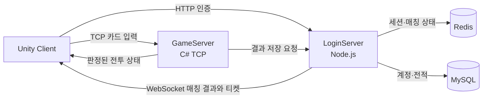

Clasher는 카드를 전장에 배치해 유닛과 스펠을 사용하는 1대1 실시간 전략 게임입니다. Unity 클라이언트의 덱·핸드·배치 입력부터 Node.js 인증·매치메이킹, C# 전투 서버의 판정과 상태 동기화까지 구현했습니다.

현재 Unity 빌드는 외부 서비스 없이 로비에서 전투 샌드박스까지 실행할 수 있는 제출용 로컬 쇼케이스입니다. 인증·매치메이킹·전투 서버는 별도 서비스로 보존했으며, 복구한 .NET 10 GameServer는 Release 빌드를 통과했습니다. 온라인 Unity 클라이언트 경로는 최신 로컬 구조에 맞춰 재통합하는 단계입니다.

## 프로젝트 개요

| 항목 | 내용 |
| --- | --- |
| 장르 | 실시간 1대1 카드 전략 |
| 클라이언트 | Unity 6.2, C#, Addressables, uGUI |
| 게임 서버 | .NET 10, TCP 바이너리 프로토콜 |
| 인증·매칭 | Node.js, Express, WebSocket, JWT |
| 데이터 | MySQL, Redis |
| 빌드 | PC 16:9, PC 9:16, Android 9:16 |
| 담당 | 클라이언트, 서버, 프로토콜, 빌드 자동화 |

## 전체 구조

LoginServer는 계정과 세션, 매칭 큐를 관리하고 입장 권한을 담은 match ticket을 발급합니다. GameServer는 티켓을 검증한 뒤 유닛 소환, 스펠, 엘릭서, 타깃과 승패를 판정합니다. Unity 클라이언트는 입력을 보내고 서버가 확정한 상태를 화면에 반영합니다.

## 매치 티켓으로 입장 권한 분리

JWT로 로그인했다는 사실만으로 임의의 전투 방에 들어갈 수 있게 하면 room ID나 player slot을 위조할 수 있습니다. 이를 막기 위해 매칭 결과와 게임 입장 권한을 분리했습니다.

매치메이커가 두 플레이어를 연결하면 room ID, player slot, 계정 ID와 만료 시간을 담은 서명 티켓을 발급합니다. GameServer는 레거시 직접 입장을 거절하고 `C_ENTER_GAME_TICKET` 경로에서 다음 조건을 다시 확인합니다.

- 티켓 서명과 타입
- 만료 시간
- 로그인 계정과 티켓 계정의 일치
- room ID와 player slot
- 이미 연결된 다른 계정이나 세션과의 충돌

인증 서버는 “누가 어느 방에 들어갈 수 있는가”를 결정하고, 전투 서버는 그 권한을 신뢰하기 전에 독립적으로 검증합니다.

## 클라이언트 입력을 서버에서 다시 판정

클라이언트가 보낸 유닛 종류와 좌표를 그대로 적용하면 엘릭서 조작, 금지 영역 소환, 중복 요청을 막을 수 없습니다. `Room`은 카드 액션을 다음 순서로 검사합니다.

1. 인게임 세션과 룸 소속 확인
2. 중복 request ID 검사
3. 요청 빈도와 request ID rollback 검사
4. 유닛·스펠 데이터 확인
5. 진영, 강과 타워 상태를 반영한 배치 영역 확인
6. 엘릭서 잔량 확인
7. 승인된 상태 변경과 패킷 브로드캐스트

서버의 카드 테이블은 9개 유닛 type과 2개 스펠 type의 비용, HP, 공격력, 사거리, 이동 속도와 공중·지상 타깃 규칙을 관리합니다. 다중 소환, 스포너, 스플래시와 스펠의 타워 피해 계수도 같은 데이터에서 결정합니다.

잘못된 요청은 이유 코드와 함께 거절합니다. 짧은 시간에 요청을 반복하거나 request ID를 되돌리는 동작은 별도의 보안 상태에 기록하고, 임계치를 넘으면 해당 플레이어의 액션을 일시적으로 차단합니다.

## 재접속 후 전투 화면 복원

전투 중 연결이 끊기면 즉시 패배시키지 않고 20초 동안 재접속을 기다립니다. 같은 플레이어가 다시 로그인하면 기존 룸의 세션을 교체하고 다음 스냅샷을 전송합니다.

- 남은 전투 시간과 플레이어 진영
- 현재 엘릭서
- 여섯 타워의 HP와 파괴 상태
- 살아 있는 유닛의 ID, 위치와 HP

이 스냅샷을 기준으로 클라이언트가 화면을 다시 구성하므로 재접속 처리와 전투 표현을 분리할 수 있습니다.

## 덱과 카드 순환

로비에서는 8장의 고유 덱을 편집하고 저장합니다. 전투 시작 시 덱을 섞어 4장을 핸드에 넣고 다음 카드를 별도로 표시합니다. 카드를 사용하면 큐의 다음 카드가 빈자리에 들어오며 사용한 카드는 큐 뒤로 돌아갑니다.

유닛 카드를 드래그하면 진영과 강을 기준으로 배치 가능 영역을 계산합니다. 좌우 라인의 타워가 파괴되면 해당 라인의 전진 가능 영역도 확장되거나 축소됩니다. 스펠은 카드별 반경을 표시하고 전장 전체 좌표 안에서 사용할 수 있습니다.

카드 비용, 표시 이름, UI 프리팹과 유닛 프리팹은 `CardDataCatalog`가 연결합니다. 전투 씬에 들어가기 전에 Addressables label을 프리로드하고, 진행률·완료·실패 콜백을 분리했습니다. 로딩 backend는 테스트용 구현으로 교체할 수 있습니다.

## 오브젝트 수명과 빌드 자동화

유닛은 type별 오브젝트 풀에서 꺼내 사용하고 사망 연출이 끝나면 풀로 돌려보냅니다. 전투와 로비의 목표 프레임을 각각 60 FPS와 30 FPS로 나누고, UI는 영어·스페인어·프랑스어·독일어·포르투갈어를 런타임에 전환합니다.

`BuildPlayerCli`는 다음 세 변형을 연속으로 생성합니다.

- Windows 1136×640
- Windows 640×1136
- Android 640×1136

빌드 과정에서 화면 크기, 방향과 bundle version을 변경한 뒤 `finally`에서 기존 PlayerSettings와 active build target을 복원합니다. 에디터 메뉴와 command line 양쪽에서 같은 빌드 경로를 사용할 수 있습니다.

## 검증과 현재 상태

복구한 GameServer 솔루션을 .NET 10 Release 구성으로 빌드해 경고 0개, 오류 0개를 확인했습니다. LoginServer와 load-test 스크립트도 Node.js 구문 검사를 통과했습니다.

Unity에는 다국어 fallback과 Addressables backend를 검사하는 EditMode 테스트, Addressables 진행률과 씬 전환 뒤 덱 유지를 검사하는 PlayMode 테스트가 있습니다.

현재 서버와 클라이언트의 핵심 코드는 남아 있지만 최신 Unity 로컬 쇼케이스에서 과거 온라인 연결 계층을 분리한 상태입니다. 다음 작업은 로컬과 온라인 실행을 공통 battle gateway 아래 묶고, 두 클라이언트의 로그인부터 결과 저장까지 자동 스모크 테스트로 고정하는 것입니다.
